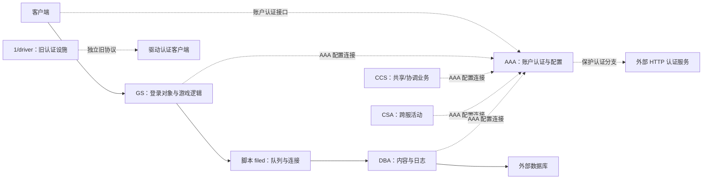
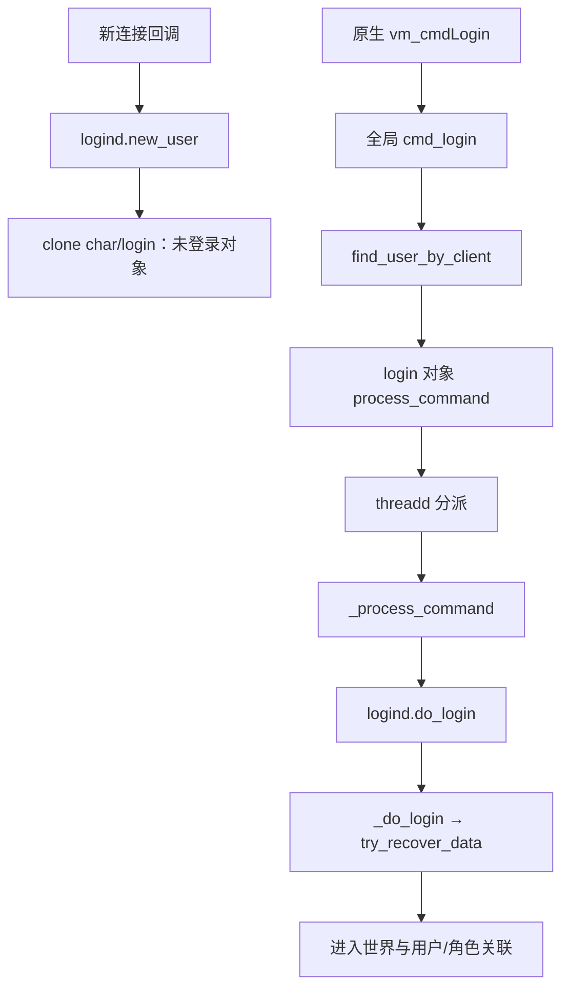

# magic_Linux32：现有服务包兼容与 Rust 重写可行性分析

分析日期：2026-10-13。目标：以 Rust 驱动直接读取现有 PAK 和 `.o`，尽量保持启动配置、脚本语义、服务间及客户端协议。延续 [首轮静态分析](magic_Linux32-static-analysis.md)，本轮没有实现 Rust 服务端，也没有执行目标、启动脚本或字节码。

## 1. 更新结论

新增部署包使评估从“是否缺少业务实现”推进到“如何兼容已有业务字节码”。**已确认：五个服务库包中的 7,159 份 VM 字节码均可按主驱动加载器恢复完整结构；9,933 条继承声明在各自包内全部找到对应对象，声明的函数、变量和继承计数一致。**因此，重写驱动并复用业务字节码具备明确技术基础，不必先把十万条函数记录还原为 Rust 业务源码。

但“完整服务可直接启动”尚未证明：存在损坏/不可解压的资源记录、缺失的内存配置文件，以及数据库、外部认证服务和运行时行为验证缺口。结构解码成功不等于解释执行等价，更不等于线上服务可用。

**推荐路线（设计判断）：**以主驱动的 **559-efun / 4 字节节点 ABI** 为首期兼容目标，先实现 PAK、字节码加载、对象/继承和值模型，再实现解释器、调度和实际依赖的驱动 API。旧认证服务采用单独兼容配置或作为外部服务保留；不要让其不同 ABI 混入主驱动加载器。首期不移植旧 x86 JIT。

### 证据层级

- **确认事实**：原始字节、Ghidra 反汇编/反编译、加载器指导的静态解码及交叉验证支持。
- **推测/建议**：服务职责归纳、实现策略和成本判断；不冒充运行观察。
- **未知**：未恢复的动态绑定、未审阅的业务分支、外部依赖与行为等价性。

所有原始制品 SHA-256 见 [输入清单](compatibility-evidence/input-manifest.json)。本轮 REA MCP 显式选择 **Ghidra 12.1.4**，完成三个分析阶段，保留 **87 条 Evidence 记录**：

| 阶段 | 可读证据 | 原始规范记录 |
|---|---|---|
| 主驱动加载器、格式和 efun 注册 | [函数与汇编](compatibility-evidence/main-rea-functions.md)、[索引](compatibility-evidence/main-rea-index.md) | [main-rea.json.gz](compatibility-evidence/main-rea.json.gz) |
| `1/driver` 旧加载器 | [函数与汇编](compatibility-evidence/auth-rea-final-functions.md)、[索引](compatibility-evidence/auth-rea-final-index.md) | [auth-rea-final.json.gz](compatibility-evidence/auth-rea-final.json.gz) |
| 对象调用与动态包接口 | [函数与汇编](compatibility-evidence/dispatch-rea-functions.md)、[索引](compatibility-evidence/dispatch-rea-index.md) | [dispatch-rea.json.gz](compatibility-evidence/dispatch-rea.json.gz) |

上述 gzip 解压后保留原始 REA JSON，没有改写 Evidence ID。PAK/VM 解码是独立 Python 工具按 Ghidra 加载器格式转换数据，**不是把 `.o` 当作原生代码交给 Ghidra，也不是执行 VM**。

## 2. 服务部署与完整性

### 2.1 启动入口和职责

所有根目录 `run*` 脚本第 5 行均调用 `magic_Linux32`；`/e` 指向包内启动字节码，`/b` 指向同一库包。下表职责为根据包成员及调用证据归纳的判断，不是对服务缩写的展开。

| 服务 | 入口成员 | 已发现的业务范围 | 字节码数 / 函数记录数 |
|---|---|---|---:|
| AAA | `aaa/start_aaa.o` | 账户认证、账户保护、服务器配置/注册；`accountd` 可追到 ADB 查询 | 202 / 1,224 |
| CCS | `ccs/start_ccs.o` | 跨服务共享数据、榜单、聊天、活动协调；存在 CSA 连接回调 | 309 / 4,044 |
| CSA | `csa/start_csa.o` | 跨服连接、赛事/活动实例及其登录逻辑 | 154 / 1,545 |
| DBA | `dba/start_dba.o` | 内容读写、日志和数据持久化；有明确 SQL 操作链 | 187 / 1,210 |
| GS | `gs/start_gs.o` | 登录对象、角色、技能、物品、场景、战斗和业务命令 | 6,307 / 93,569 |

函数数是解码出的**记录数**：公共代码可能在不同包/启动单元重复，不等于去重后的独立函数数，更不表示全部函数都已人工审计。

`1/1` 第 1 行启动另一 ELF `1/driver`，先加载 `auth_srv.o`，再加载 `pwd.o`，另有 Telnet 配置。其认证程序可见 TCP/UDP daemon、DES 请求处理及配置查找，是独立的旧认证设施；不能把它与 AAA 的游戏账户认证混为一谈。



图示是静态代码和配置所支持的关系，不是实测连接拓扑。AAA 向 GS 交付登录结果的完整协议、各服务完整依赖顺序尚未闭合。

### 2.2 配置与发现的问题

- `runccs` 使用 `ccs/ccsmem.cfg`；GS 使用 `gs/gsmem.cfg`。`rundba` 引用的 **`dba/dbamem.cfg` 不存在**。原生配置函数有缺省配置路径，缺失不自动等于必然启动失败，但不能称该部署配置完整。
- GS1/2/3 共用同一个入口，只更换 `CONFIG=gs/gsN.ini`。GS2/3 的 AAA 地址与 GS1 不同；这是部署差异，未验证连通性。数据库密码及授权字段未复制到报告。
- GS 配置声明 `MAX_USER=512`。`[REBOOT] SERVER_PORT=9257` 的用途已由 `init_service_module` 补证：它读取该字段，可能经 `configd.my_port` 覆盖，最终调用 efun `start_service_on`。因此 **9257 是配置期望的 GS 监听端口，实际监听及覆盖值未观察**。
- `init_service_module` 同时尝试与 CCS 同步时间，并有错误/挂起分支。兼容启动不是加载 GS 单包即可完成。
- `1/clients.cfg` 与 `1/service/clients.cfg` 哈希不同；后者处在启动指定的服务根目录下。二者不能合并当作同一认证配置。
- 新资源包包含协议说明和数据库配置描述，但未发现可据以还原完整数据库部署的 schema、数据、索引和存储过程集合。

## 3. PAK 格式与全包恢复

### 3.1 Ghidra 依据

主要函数地址：

| 函数 | 地址 | 关键观察 |
|---|---|---|
| `vm_packedFsFetch` | `0x080b40c0` | 拆分 `.pak/` 路径后调用 `fm_unpack` |
| `vm_packedFsFileOpen` | `0x080b41a0` | 解包为内存 I/O；目录属性不作为普通文件打开 |
| `fm_readCatalog` | `0x080b51ec` | 16 字节头、64 字节目录项、逐层目录、名称比较不区分大小写 |
| `fm_unpack` | `0x080b5500` | 按属性读取原始数据或 LZSS；比较解压长度 |

`fm_unpack` 的 Evidence：`ev_14ecbc2d3556c5e3a775b1b2fd7154aabd4a64448fa6cda902a3aedf7f8087bc`。`fm_readCatalog` 的 Evidence：`ev_cc310fbbb5402e75d2c6ecae8ccd0be9312414b23edd2556b0d93fe81d2004fa`。所有准确入口都可由附件的函数标题和记录复核。

Ghidra 恢复的头为 16 字节：`nSign`、`nRootDirSize`、两个 unused 字段，均为本样本的小端 32 位字段。12 个包实际签名为 `0x11223344`，根目录紧随头部。**观察到的 `fm_readCatalog` 没有显式校验签名**；本轮独立提取工具的签名检查是分析工具约束，不冒充旧驱动行为。

目录项布局证据：`ev_536fe11b9021d07306bd665891edb9b1ed1ebe0a7334c83c44de5e8aba02f55b`。

| 项内偏移 | 宽度 | 字段 |
|---:|---:|---|
| 0 | 4 | 属性 `nAttrib` |
| 4 | 4 | 包内绝对偏移 `nOffset` |
| 8 | 4 | 存储长度 `nSize` |
| 12 | 4 | 原始长度 `nOrgSize` |
| 16 | 4 | 修改时间字段 |
| 20 | 44 | 名称字节数组 |

属性位 `1` 表示目录；`0x80000000` 表示原始存储。`fm_unpack` 在 `attrib & 0x80000001 == 0` 时进行 LZSS 解压，否则直接读原长度。目录本身由 64 字节项组成，子目录偏移也相对于整个包。记录没有显示独立内容 checksum 字段；本报告的 SHA-256 是分析生成的完整性标识。

```c
// fm_unpack 的整理版；不包含 unpack-to-host 的替代模式。
int unpack_member(PakFile *pak, const char *path, Bytes *result) {
    Catalog c;
    if (!lookup_catalog_case_insensitive(pak, path, &c)) return 0;
    seek(pak, c.offset);
    if ((c.attrib & 0x80000001u) == 0) {
        n = lzss_decode(pak, c.stored_size, result, c.original_size);
        if (n != c.original_size) return 0;
    } else {
        read(pak, result, c.original_size);
    }
    return 1;
}
```

### 3.2 覆盖结果

| 包 | 文件记录数 | 识别为主 ABI 字节码 |
|---|---:|---:|
| AAA `etc.pak` / `lib_aaa32.pak` | 16 / 202 | 0 / 202 |
| CCS `etc.pak` / `lib_ccs32.pak` | 139 / 309 | 0 / 309 |
| CSA `etc.pak` / `lib_csa32.pak` | 16 / 154 | 0 / 154 |
| DBA `etc.pak` / `lib_dba32.pak` | 10 / 187 | 0 / 187 |
| GS `etc.pak` / `lib_gs32.pak` | 1,393 / 6,307 | 0 / 6,307 |
| GS `server_animates.pak` / `server_maps.pak` | 32 / 157 | 0 / 0 |

共枚举 **9,527 项：605 个目录、8,922 个文件记录**；8,921 个文件成功取得内容并计算哈希。

唯一解压异常为 `dba/pack_data/etc.pak/etc`：目录项位于 **`0x210`**，属性 `0`，数据偏移 `6901897`，存储长度 **0**，原始长度 **7,829,223**。按加载器规则无法满足解压长度。这是明确格式异常，不是未经证据确认的“缺少某个业务文件”；该记录是否被实际访问尚不确定。

资源中的 `comm_desc.txt` 有 `cmd_l_account(...)`、消息类型、参数宽度和封装描述；与驱动动态包接口相符。`config.sql` 没有匹配到 `CREATE TABLE` 定义，文件名不能证明它就是完整数据库建表脚本。[资源摘要](compatibility-evidence/resource-summary.json)保留制品哈希及格式线索。

全成员路径、属性、偏移、长度和哈希在 [members.json.gz](compatibility-evidence/members.json.gz)；包统计在 [packages-summary.json](compatibility-evidence/packages-summary.json)。未将所有资源展开成大量散文件，原始包仍是内容来源。

## 4. 主驱动字节码 ABI

### 4.1 格式与加载器事实

[`vm_loadBinary`](compatibility-evidence/main-rea-functions.md#vm_loadBinary) 的入口为 `0x080b9264`。它要求头部魔数 **`0x10001`**，跳过第二个 32 位字段，并要求第三个字段匹配当前全局函数基数。第二字段的意义未在本轮确认，不据其数值推断编译日期。

关键加载函数：

| 函数 | 地址 | 兼容约束 |
|---|---|---|
| `vm_loadDefines` | `0x08087080` | 定义数量、参数数量、名称及展开文本 |
| `vm_loadIdentifiers` | `0x08087fb8` | 名称池、变量、函数、efun 总数、DLT |
| `vm_loadFun` | `0x080959b8` | 64 字节函数记录、名称、20 字节参数记录、代码段 |
| `vm_loadCodeSegment` | `0x08096128` | 符号、4 字节节点、metadata、runtime 信息和字符串重映射 |
| `vm_loadBinaryInherit` | `0x080a2b58` | 已加载对象、基数偏移、继承/函数/变量计数匹配 |
| `vm_loadComment` | `0x080b8800` | 本构建直接返回 1，不消耗注释标记 |

`vm_loadCodeSegment` Evidence：`ev_edcc9ae3360df89029b6c17c970dcbe35359f22edebb0f04fe7b3757b2f81681`；`vm_loadIdentifiers`：`ev_b786ac699461a76c0683ddb2f8254575187db56f002088762956ac65e57e9528`。布局与写出路径由 `vm_saveBinary` / `vm_saveIdentifiers` 反向核对，避免只凭解码能走到底推定格式。

确认的主格式顺序为：

1. 三个 32 位头字段；定义表；字符串池。
2. 名称池；16 位变量计数；对象模式下的程序变量记录。
3. 16 位 efun 与函数计数；隐藏函数；对象继承表。
4. 20 字节 DLT 记录及其函数内容；顶层初始化代码段。

对象和全局单元的结构不同；解码器尝试两种上下文，只有**唯一一个能完整解析且无尾随字节**时接受。本语料中是 **7,154 个对象单元 + 5 个全局启动单元**。主字节码整数按小端恢复，与大端网络字段必须分开处理。

代码段先恢复变化编码的文件/行号符号，随后读取节点数及 `count * 4` 字节节点、metadata 长度与内容、runtime count 与 `count * 4` 内容。节点包含 `par16:int16`、`par8:int8`、`opcode:uint8`，metadata 的读取必须服从动作表参数规则。指针宽度为 32 位的旧记录不能直接反序列化为 Rust 宿主指针；加载器本身也会清空/替换序列化指针字段。

### 4.2 数字、偏移与继承必须一致

- 五个启动单元的 `function_base` 都为 **572**，efun 总数都为 **559**。
- 主驱动静态注册顺序能恢复 559 个 efun 的**名称→编号→原生入口**；库包的编号必须按此顺序解释。注册可选 Apex 模块会改变配置，不能只保留“相同名称集合”而打乱编号。
- 572 与 559 的差额是 **13 个已有全局函数槽**。首轮恢复的内嵌脚本确有 13 个函数定义，与此一致；具体编号的完整 bootstrap 重建仍需作为实现验收，不将数量相符当作全部绑定已经证明。
- 对象继承不仅按名称加载，还包含 constitution、函数及变量基数，以及期望计数；加载顺序影响这些值。**9,933 条继承边的三类计数均匹配**，见 [inheritance.csv](compatibility-evidence/inheritance.csv)。这证明本语料的继承目标静态闭合，不证明所有动态对象路径或启动顺序闭合。

### 4.3 实际使用规模

| 指标 | 主服务包静态结果 |
|---|---:|
| 完整解码的字节码单元 | 7,159 |
| 命名函数记录 | 101,592 |
| 隐藏函数记录 | 0 |
| 指令节点 | 6,474,773 |
| 使用的 opcode | 73 种 |
| 直接 efun 调用点 | 143,520 |
| 直接 efun 名称 | 312 种 |
| 跨对象调用 opcode8 | 366,483 个静态节点 |

metadata 边界和共享字符串池索引检查通过；没有把每条指令都执行或逐条人工解释。未直接引用的 efun 仍可能由函数值、名称查找、调试路径或配置调用，因此首期可以按 312 个直接依赖优先实现，**但应保留完整 559 个 ABI 槽位，不能据静态未引用就删除**。

50 个全局数字调用点暂未与服务包中的函数记录绑定，索引集中在 `559/564/569/570`，都位于内嵌全局函数区。它们是 bootstrap 绑定边界，不应报告为缺失 50 个业务函数。[兼容统计](compatibility-evidence/compatibility-summary.json)、[efun 编号表](compatibility-evidence/efuns.csv)、[API 使用表](compatibility-evidence/efun-usage.csv)可复核上述结果。

## 5. 真正的业务路径与对象分派

### 5.1 GS 登录：比原生 cmdLogin 多一层对象状态

首轮确认原生 `vm_cmdLogin @ 0x08054da8` 将字段交给全局 `cmd_login`。本轮找到该函数的实际包内实现，并继续追到了未登录对象。

以下偏移全部为**解压后的成员内函数记录偏移**，不是 ELF 地址；包内压缩数据偏移另见成员清单。

| 成员 | 函数 / 编号 | 记录偏移 | 证据化行为 |
|---|---|---|---|
| `gs/start_gs.o` | `do_when_cmd_new_connection` / 1207 | `0x1762a8` | 常量路径 `logind.c` 和方法 `new_user` |
| `gs/daemons/logind.o` | `new_user` / 41 | `0x1b508` | node3：`clone_object('/gs/clone/char/login.c')` |
| `gs/start_gs.o` | `cmd_login` / 1195 | `0x115de7` | 版本/DES 处理；node139：用户对象 `process_command('login',...)` |
| `gs/clone/char/login.o` | `process_command` / 221 | `0x4856` | 经 `threadd.dispatch` 处理 |
| 同上 | `thread_process_command` / 218 | `0x2c6c` | 调用本程序 `_process_command` / 215 |
| 同上 | `_process_command` / 215 | `0x3aaa` | node68：`logind.c` 的 `do_login`，argc2 |
| `gs/daemons/logind.o` | `do_login` / 79 | `0xcdb7` | 登录许可、状态/快速登录；node1110 调 `_do_login` |
| 同上 | `_do_login` / 78 | `0x10911` | 调用 `try_recover_data` |
| 同上 | `enter_world` / 34 | `0x9bda` | 角色/用户关联、日志、在线账户广播与限制检查 |

可读指令证据见 [bytecode-listings.md](compatibility-evidence/bytecode-listings.md)，包括 pc、成员内指令位置、调用编号及常量；完整结构在 [programs.json.gz](compatibility-evidence/programs.json.gz)。



`cmd_login` 的实际节点调用 `trim`、`sscanf`、`isxdigit`、`restore_value` 和 `des`，含版本常量 **`1.60.0905`**。失败路径有版本不匹配和断开连接处理。这能支持客户端兼容要求的判断，但不是整个驱动的版本号。

**重要纠正：**`gs/cmds/normal/login.o:main` 只有 15 个节点，用于已登录对象再输入 login 时提示先 logout，不能把这个同名成员当成真实未登录认证入口。Rust 必须保留“接收对象的类型/状态决定方法”的语义。

原生 [`vm_callInOtherFun`](compatibility-evidence/dispatch-rea-functions.md#vm_callInOtherFun) 支持按字符串对象名或对象值查找方法，并有继承查找、`default_interface` 回退、缺失方法错误/void 路径。它的 Evidence 为 `ev_4b89eec3bfa71f6f357f508600108ff4f54e9492ffa2c51e8012d5d1a8ce8db0`。这补强了 opcode8 的解释；实际对象加载、实例选择和运行结果仍不是静态观察能够证明的。

### 5.2 AAA 账户认证与外部保护服务

`aaa/daemons/accountd.o` 包含 `account_login → _account_login → check_account_info`，后者调用 `query_account_info`。`query_account_info` 的记录位置为 **`0x1927e`**、编号 **41**，包含 ADB 连接与参数化 SQL：`select * from account where account = ?`。后续还调用原生 `get_pwd` 和保护状态检查。

`auth_all_protect` 处理多种账户保护分支，最终 `send_login_result` 向 agent 发送消息。另有 `pwdprotect_authd.o:to_auth_protect`（编号1、记录 **`0x13cf`**）通过 `/daemons/http_clientd.c` 的 `http_get_web` 发起保护认证；代码含成功、解绑、URL、网络和超时结果分支。**确认：**这些外部服务接口在字节码中存在。**未知：**当前端点可用性、完整服务契约，以及 AAA 向 GS 交付结果的全部协议。

### 5.3 持久化：GS → DBA → SQL

GS 的 `daemons/filed.o` 中，`create_content/read_content/write_content` 调用 `do_operate`；`dba_comm`（编号101、记录 **`0x1e27`**）通过队列和 `send_to_client` 发请求。`try_to_connect_dba`（编号7、**`0x39fb`**）从 configd 取得 DBA 地址，调用 socket、connect、bind_to_client，再发送数据。

DBA 的实际实现位于 `dba/daemons/dbaserver/`：

| 成员 main | 记录偏移 | SQL/操作证据 |
|---|---|---|
| `cmd_create_content.o` | `0x253` | DDB、校验和、`mysql_bind_parameters`、INSERT data |
| `cmd_write_content.o` | `0x409` | 更新 path/name/branch/content/time/checksum；含运行状态判断 |
| `cmd_read_content.o` | `0x405` | 查询 data/data1，校验内容，再回复 |

读操作 node57 的全局函数编号 **955** 对应 `start_dba.o:mysql_select`，所以数据库读取判断同时得到数字调用边和 SQL 常量支持，而非仅凭字符串猜测。DBA 中空的 `daemons/filed.o` 是占位单元，不代表该持久化实现不存在。

GS 用户保存还涉及物品、仓库、卡片、补丁和继承方法。Rust 不应把这些脚本存储行为替换成一种全新的 JSON 表结构而宣称兼容；首先需要复刻 `save_string/restore_value`、buffer 内容、校验和、消息关联及旧数据库读写语义。

### 5.4 动态协议注册不是固定命令表的附属细节

本轮 `vm_pktAnalyse @ 0x080c1f18` 确认：按消息号和类型位取接口，匹配字段，按 array/mapping 封装，必要时附加剩余数据，然后 `vm_applyFun` 调用注册函数。`vm_pktDeclareInterface` 用接口名的大写宏解析消息编号，并保存回调与封装类型。

因此兼容重写须同时支持首轮的原生 `_cmdIndex` 和脚本驱动的动态 packet interface；只把原生命令表移植为 Rust `match` 会遗漏服务间和动态注册接口。对应 Ghidra Evidence：`ev_d5c9ac160ffdb1d78b521059303ebf16a54735bf20749764cdb4442cfc69b9d5`、`ev_77270df67d67e7cda8223a8169b5a62d0aecef52af7ee6847132044e05b259e2`。

## 6. 旧认证驱动：相同魔数，不同 ABI

`1/driver` SHA-256：`cf4967c010af494f7ce9ec4626661df09bc7ef46028f019ba5447965fb82a6c7`。Ghidra 识别 5,370 个原生函数；其 `main` 注册 MySQL、SQLite、TinyXML 和语言模块，次序与主驱动不同。

| 项目 | magic_Linux32 主格式 | 1/driver 旧格式 |
|---|---|---|
| `.o` 魔数 | `0x10001` | `0x10001` |
| efun 总数 | 559 | 389 |
| efun 记录宽度 | 28 字节 | 32 字节 |
| 函数记录宽度 | 64 字节 | 44 字节 |
| 参数/局部变量记录 | 20 字节 | 24 字节 |
| 索引/计数 | 多处 16 位 | 多处 32 位 |
| 指令编码 | 固定4字节节点 + metadata | 4字节描述 + 可变参数/字符串/源位置 |
| 字符串 | 独立池和重映射 | 指令可附带字符串 |
| 内部执行节点 | opcode/索引上下文 | 加载后40字节节点、例程指针及参数 |

关键地址：`vm_loadActions @ 0x08070cc8`、`vm_loadProgram @ 0x0806351c`、`vm_doActions @ 0x08071478`。旧 `vm_loadActions` 的 Evidence：`ev_c7666e4a4d210b139fa43d32efb1990b4deff53f25cc156b59bba55a747a6039`。相关 44/24 字节布局由 Ghidra 类型记录独立支持。

旧指令描述的字节依次为 flag、parameters、instruction、unused；flag 决定是否随后读取文件名或行号。参数值 `255` 表示特殊参数区域路径，加载器仍读取至多四个32位值；字符串和 switch 表有额外数据。这解释了两份 `.o` 为何不能用主格式加载，而不是将 `file` 的 Windows INF 误判当事实。

按该旧规则：

- `auth_srv.o` 全部解析，efun389、函数基数389、定义13个函数。
- `pwd.o` 全部解析，efun389、函数基数402、没有新增函数。
- 389 + 13 = 402，与 `1/1` 中先基础脚本后启动脚本的顺序吻合。

认证程序的 `process_request`（记录 **`0x14d6`**）先取得客户端配置、DES 解码，再转入 `process_request_1980`；初始化调用 `load_config('clients.cfg')`，启动 TCP/UDP daemon。原始字节及逐指令位置见 [旧字节码附件](compatibility-evidence/auth-bytecode-listings.md)、[auth-programs.json.gz](compatibility-evidence/auth-programs.json.gz)、[389 项 efun 表](compatibility-evidence/auth-efuns.csv)。没有执行认证请求，也未复制配置中的授权密钥。

**兼容决策：**以样本哈希/明确格式配置区分两套解码器，不能只按 `0x10001` 自动判定。首期替换主驱动时，旧认证服务可留在原有外部接口边界；若要求连 `1/driver` 一并替代，再实现 legacy loader 和对应 API 语义，不能把旧字节码误当损坏主格式。

## 7. Rust 实现边界与分阶段验收

### 7.1 可行性矩阵

| 模块 | 判断 | 本轮新增依据 / 剩余要求 |
|---|---|---|
| PAK读取、路径、LZSS | 高 | 12包目录和内容覆盖；保留不区分大小写及虚拟路径语义，异常记录须显式失败 |
| 主字节码加载 | 高 | 7,159单元完整解码；不能把 Python 格式检查视为执行实现 |
| 继承与重定位 | 高但不可省略 | 9,933边静态闭合；必须复刻constitution、函数/变量基数、字符串映射和加载顺序 |
| 解释器和值模型 | 可行，主要工作量 | 73种实际opcode；共享/引用/转换/异常及对象语义尚需逐项实现验证 |
| efun ABI | 可行 | 完整559槽位已恢复；312个直接依赖优先，动态路径不能忽略 |
| 协议及网络 | 可行 | 原生包头、动态packet接口、队列/连接路径可见；需完整消息布局、时序和错误码 |
| 调度、线程和回调 | 中等风险 | 未登录对象经threadd；协作调度、挂起和重入必须保持，不宜一PCB一异步任务直接替换 |
| DB和持久化 | 条件可行 | SQL、表字段、内容保存链已定位；真实schema、数据、事务/编码行为未验证 |
| 认证 | 条件可行 | AAA与旧驱动两层可分；外部HTTP及认证服务契约仍有缺口 |
| 编译器/运行时eval | 不能默认删除 | 每服务均有 `compile_program`、`execute_data` 静态调用；bootstrap .c 也依赖编译 |
| JIT | 不宜首期复刻 | 旧x86模板与宿主ABI绑定；解释器先证明语义等价，再决定新JIT |
| 完整服务器等价 | 尚未证明 | 结构恢复与典型业务路径不替代所有分支及运行验证 |

`compile_program` 和 `execute_data` 各有5个直接调用点，`clone_object` 有3,870个、`create_thread` 有200个。这里是静态调用点，不能声称都在正常启动执行，但足以说明“只读 `.o` 就可删除全部编译能力”没有证据支持。

### 7.2 模块和接口建议

建议建立 `artifact`（PAK/格式）、`loader`（重定位）、`value/object`（带标签值与对象）、`vm`（指令及调用帧）、`scheduler`（状态与定时器）、`driver_api`（固定ABI表）、`transport`（包与接口）、`persistence`（旧格式/SQL边界）模块。以下是未来设计，不是本轮已实现API：

```rust
enum AbiProfile { Magic559, LegacyAuth389 }
struct ProgramImage { /* 显式索引、记录与符号；不含宿主指针 */ }
struct ObjectId(u32);
enum ExecState { Ready, Waiting, Suspended, Finished, Failed }
// load_program(profile, bytes, load_context) -> Result<ProgramImage, LoadError>
// step(object, frame, budget) -> ExecState
// invoke_efun(index, typed_arguments, context) -> Result<Value, VmError>
```

- 保留32位整数/字段和明确端序；宿主无需32位。序列化指针只作不透明旧字段，重建为索引或受控句柄。
- 字符串优先保存原始字节；文本展示的UTF-8/GB18030推定不能成为执行语义。路径/标识符、中文文本、buffer与序列化转换分别处理。
- 使用受控对象存储保留共享、引用、复制和析构语义；Rust所有权不会自动等价于旧VM的别名和循环引用行为。
- 通过明确错误/执行状态复刻 `setjmp/longjmp`、catch、挂起与返回hook，不让非局部跳转跨 Rust 栈。
- 数据库及外部库可通过适配层或隔离FFI接入，但参数类型、结果编码、NULL、错误码、事务及连接重试必须依据旧行为；不能只替换同名库调用。
- JIT及FFI是未来 `unsafe` 边界，先以解释器验证；本轮未选择第三方crate、安装依赖或创建Cargo项目。

### 7.3 实施顺序与退出标准

1. **离线兼容工具层**：读取全部12包、保留异常项、解码两种ABI。验收以本轮哈希、成员清单、7159+2单元结构和继承计数作为固定语料；全部读取无隐式格式转换。
2. **主解释器最小内核**：实现73种语料opcode、值/对象/继承、调用帧和错误状态；建立559项编号表及明确的未实现API错误。验收自制程序与静态导出的算术、容器、方法回退、挂起和重定位预期。
3. **bootstrap和启动路径**：重建已有13个全局槽及顺序，按包内入口加载模块和对象。可先把已恢复内嵌脚本转为受控bootstrap，但不得改变可观察接口；没有运行时编译能力时要明确功能限制，不能声称完整兼容。
4. **服务协议与数据库边界**：优先补AAA登录、GS登录对象、DBA内容读写、CCS时间同步和动态packet接口。用可控测试替身验证请求/回复及错误分支，再接入实际依赖。
5. **完整能力和后续验证**：补运行时编译/eval、其余动态API、旧认证ABI；获得另行授权后才开展原程序差分、网络互操作、恢复和性能测试。语义稳定后再评估新JIT。

第1阶段的Python静态工具已在本轮完成；后续阶段是重写建议，未实现也未执行原程序作验证。

## 8. 复现、检查与仍未完成的分析边界

静态复现工具只读取制品，不加载ELF或解释VM：

```sh
python3 docs/compatibility-evidence/inspect_packages.py
python3 docs/compatibility-evidence/inspect_auth.py
python3 docs/compatibility-evidence/summarize_programs.py
```

工具锁定 [输入清单](compatibility-evidence/input-manifest.json) 中的PAK、ELF及独立`.o`哈希；其他报告数据为派生结果。核心证据来自Ghidra，Python负责格式转换和计数，CodeGraph仅用于已有本地分析工具的定位，不作为二进制语义证据。

### 已完成的检查

- 全12包目录边界/成员位置检查；逐文件解压长度和内容哈希，保留唯一异常记录。
- 7159份主格式结构全部消费至EOF，metadata及共享字符串索引检查；两份旧格式消费至EOF。
- 全部9933条继承边的目标和声明计数匹配；559/389两套原生API注册数量与字节码记录匹配。
- 独立LZSS字面量样例、代表启动成员哈希检查，以及11个截断、尾随字节、错误魔数/压缩长度等畸形输入拒绝检查。
- 报告链接、锚点和Evidence ID检查；原始输入哈希对照；REA会话关闭。没有把这些静态检查写成运行时兼容测试。

完整检查摘要见 [validation.json](compatibility-evidence/validation.json)。清单中的36个原始制品与启动文件哈希未变；`AGENTS.md` 在会话中收到新的用户指令，其基线差异单独记录，不作为二进制或包修改。

### 明确的部分覆盖和未知项

1. **全部语法/指令语义**：结构能解析、使用集已统计；并未把73种opcode和312个API的所有分支逐一证明，完整编译器与动态eval规格仍需继续恢复。
2. **调用图**：数字本地/全局调用可解析一部分；对象调用、函数值、回调及动态路径不能全部静态确定。本轮登录及持久化链是代表路径，不是完整服务端CFG。
3. **协议闭合**：已找到动态packet定义和服务通信路径；AAA→GS认证交付、全部命令、重连/超时/错误消息仍未完整恢复。
4. **部署和数据**：`dbamem.cfg`缺失、DBA资源记录异常；数据库数据与完整schema、HTTP保护服务和认证服务可用性未验证。
5. **旧格式边界**：旧解析器覆盖提供的两个全局`.o`，没有实现任意旧对象继承格式。不能扩称覆盖全部历史Gameshell版本。
6. **行为和性能**：没有运行原ELF、服务或恢复脚本，因此尚不能证明启动、交互、事务、并发、恢复与性能等价。

与首轮相比，业务字节码、资源目录、efun编号、继承闭合以及GS登录/DBA持久化路径已经补证；“存在完整可运行Rust替代品”仍然不是本轮结论。最有依据的下一步是实现兼容运行时，而非先重写包中的全部业务函数。
