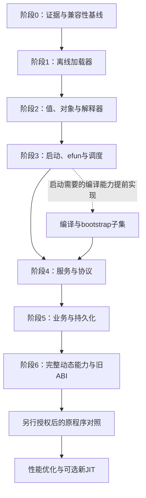

# magic_Linux32 Rust 重写实施路线图

本文采用“总体方案 → 分阶段实施 → 验收与风险”的总—分结构，面向后续实现兼容运行时的工程师。依据截至 2026-10-13 的 [静态分析](magic_Linux32-static-analysis.md) 与 [服务包兼容性分析](magic_Linux32-rust-compatibility-analysis.md)。本文是实施方案，不表示 Rust 服务端已经实现或原程序已经运行验证。

**实施进度：**阶段 1 离线加载器见 [阶段 1 文档](rust-offline-loader.md)；阶段 2A 的值模型、对象存储和 28 种指令限定路径见 [VM 核心语义](vm-core-semantics.md)。完整解释器、调度和服务端仍未完成。

阶段 2F 已实现数值自增减与十种数值复合赋值，共 52 种限定指令路径；见 [数值更新语义](vm-numeric-updates.md)。

阶段 2E 已完成稳定值槽、引用与成员标量写入，共 50 种限定指令路径；API 迁移和限制见 [受限引用运行时](vm-reference-runtime.md)。阶段 2D 的原始证据与设计见 [引用静态分析](vm-reference-semantics.md)。

阶段 2C 已实现不可变数组和普通映射，共 43 种限定指令路径；见 [容器语义文档](vm-container-semantics.md)。

阶段 2B 已扩展至 39 种限定指令路径，实数、数值转换与位运算的证据和限制见 [数值语义文档](vm-numeric-semantics.md)。执行验证仍限人工构造程序。

## 一、总体方案

### 1.1 目标与边界

以 Rust 重写原生驱动，直接加载现有 PAK 和 `.o`，逐步保留脚本语义、启动配置、客户端协议、服务间通信和持久化行为。业务字节码继续作为业务实现来源，不先将全部业务函数翻译成 Rust。

首期兼容主驱动的 `Magic559` ABI；`1/driver` 对应的 `LegacyAuth389` 是独立兼容目标。主服务的 AAA 账户认证与旧驱动认证设施应分别建模。初期保留旧认证服务的接口边界，完整 Rust 替代阶段再实现旧 ABI；这不是启动旧服务的授权。

实施以解释器为主线：先证明语义与接口兼容，再优化性能。暂不移植与 x86 宿主绑定的旧 JIT。不因已有 `.o` 就删除编译器：资源中实际存在 `compile_program`、`execute_data` 调用，内嵌脚本启动也有编译依赖。

路线图初次交付只包含文档；后续实施进度另行标记。原始 ELF、PAK、`.o` 和启动脚本保持不变，不执行原程序、脚本或字节码。原程序运行对照需要另行授权。

原版运行对照环境需提供 `/lib/ld-linux.so.2`、`glibc.i686` 和 `libstdc++.i686`；离线 Rust 工具按宿主架构构建，不继承这两项 32 位运行依赖。

### 1.2 已有基础与证据分级

| 已确认的静态基础 | 实施意义 | 不代表什么 |
|---|---|---|
| 12 个 PAK，9,527 个目录及文件项；8,921 个文件内容成功恢复 | 可建立固定加载器语料 | 不证明所有资源正常，另有 1 个异常文件记录 |
| 7,159 个主 ABI 单元完整结构解码 | 可复用现有业务程序 | 不证明字节码执行等价 |
| 9,933 条继承关系目标与声明计数匹配 | 可验证继承和重定位 | 不证明动态对象加载顺序闭合 |
| 559 个 efun 槽，312 个直接引用的名称 | 编号表可固定，实现可按依赖排序 | 不证明其他槽永远不会调用 |
| 主语料使用 73 种 opcode | 可确定首期解释器覆盖集合 | 不证明所有操作码分支语义已恢复 |
| 旧认证 ABI 的 2 个全局单元可解码 | 可单独建立旧格式测试集 | 不证明任意旧对象或继承格式兼容 |

**事实**须指向原始字节、Ghidra 结果或可复核的静态提取；**设计建议**表示本路线选择；**未知项**进入待验证清单。每个实现任务记录其证据、测试和剩余限制，不能将结构解析成功作为运行兼容结论。

### 1.3 架构与接口

| 模块 | 职责及关键约束 |
|---|---|
| `artifact` | PAK、目录查找、LZSS、虚拟路径；保留名称比较和压缩属性规则 |
| `loader` | 程序格式、字符串映射、继承及重定位；旧指针字段不能成为宿主指针 |
| `value` / `object` | 带标签值、对象身份、共享、复制、析构及方法分派 |
| `vm` | 指令、调用帧、返回值、异常和执行预算 |
| `scheduler` | 协作执行、定时器、等待、挂起和回调恢复 |
| `driver_api` | 固定 efun 编号表、参数约束、配置及启动全局函数 |
| `transport` | 原生封包、动态协议声明、连接与消息队列 |
| `persistence` | 旧序列化格式、数据库结果及外部服务适配 |

以下为拟采用的接口边界，尚未实现；具体字段应由对应阶段的语义证据确定：

```rust
enum AbiProfile { Magic559, LegacyAuth389 }
struct ObjectId(u32);
enum ExecState { Ready, Waiting, Suspended, Finished, Failed }
// load_program(profile, bytes, load_context) -> Result<ProgramImage, LoadError>
// step(object, frame, budget) -> ExecState
// invoke_efun(index, arguments, context) -> Result<Value, VmError>
```

程序映像使用显式索引及受控句柄，ABI 由明确配置选择，不能只凭两套格式共有的 `0x10001` 魔数判定。字符串默认保存原始字节；整数宽度、溢出、浮点转换和端序明确实现，不采用宿主默认行为替代旧 VM 语义。

### 1.4 实施顺序与交付层次



交付分别标记为：**离线资源兼容工具**、**最小主 ABI 运行时**、**指定流程服务兼容版本**、**完整目标兼容版本**。每次发布写明已支持的输入和行为，未通过后续阶段时不使用“完整替代”表述。阶段是依赖顺序，不是未经评估的工期承诺。

## 二、分阶段实施

### 阶段 0：固定证据与兼容性基线

**目标与输入：**以现有输入清单、Ghidra 证据、格式统计及启动配置建立后续验收基准。已有 Python 静态工具属于分析基础，尚不是 Rust 加载器。

**任务：**

- 核对制品哈希和解析统计，保持原始输入只读；派生文件单独保存。
- 为操作码、efun、值语义、动态调用和协议建立证据与实现状态表，状态使用“已确认／待验证／未实现／已测试”。
- 登记数据库 schema 与数据、外部 HTTP 认证契约、AAA→GS 交付协议等缺口；记录缺失的 `dba/dbamem.cfg` 和异常资源，避免静默补造。

**产物与验收：**版本化语料清单、兼容矩阵和未决问题清单。每项确认结论可回到证据；没有真实凭据复制到文档或测试样例。基线固定后进入阶段 1。

### 阶段 1：实现 Rust 离线加载器

**目标与输入：**直接读取原始 12 个 PAK 和主 ABI `.o`，与现有成员清单、程序统计及继承表核对。

**任务：**

- 建立 Cargo 项目：实现放入 `src/`，集成测试放入 `tests/`，小型可复现输入放入 `tests/fixtures/`。
- 实现目录边界、包内绝对偏移、属性位、大小写比较、LZSS 和虚拟路径解析。
- 实现对象／全局单元格式、字符串池、代码节点、metadata、符号和继承记录；拒绝截断、越界及无效引用。
- 分离解析结果与运行状态，不反序列化宿主指针；记录严格格式检查与旧驱动行为的差异。

**产物与验收：**离线检查工具、结构化程序映像及错误报告。12 包枚举结果与基线一致，7,159 个主单元完整消费至 EOF，9,933 条继承目标和计数匹配；可恢复成员内容哈希一致。

已知异常 `dba/pack_data/etc.pak/etc` 必须显式报告，不用空内容冒充成功。旧 ABI 此阶段只要求明确识别为不同配置；其完整支持进入阶段 6。离线兼容通过后进入阶段 2。

### 阶段 2：实现值、对象和解释器核心

**目标与输入：**以主驱动动作表、调用例程和静态程序映像实现主语料实际使用的 73 种操作码。

**任务：**

- 逐项恢复值标签、32 位数值计算、混合类型转换、字符串／buffer 区别、数组和 mapping 行为。
- 建立对象存储、克隆、继承重定位、函数值、调用帧和方法查找；保留 `default_interface` 及缺失方法分支。
- 明确共享引用、复制和销毁规则，包括循环引用；不能把 Rust 所有权直接当作旧 VM 语义。
- 用错误与执行状态实现 catch、返回 hook 和非局部退出，禁止跨 Rust 栈模拟 `longjmp`。

**产物与验收：**可执行人工构造小程序的解释器和操作码语义表。73 种操作码均有实现及针对性测试；算术边界、别名修改、继承调用、异常传播和非法程序失败路径有明确预期。未知语义继续标记，不以任意默认值通过测试。

### 阶段 3：实现 bootstrap、efun 和调度

**目标与输入：**固定 559 项 ABI 注册顺序，重建启动前全局函数及协作执行环境。

**任务：**

- 恢复启动单元所需的 13 个已有全局槽及编号顺序，验证全局基数 572；数量匹配不能替代完整绑定证明。
- 保留全部 559 个 efun 槽，按启动路径和 312 个直接依赖排序实现。未支持调用返回明确的兼容错误，不以无操作或默认成功替代。
- 采用受控 VM 执行队列，验证 FIFO、定时器、线程分派、等待、挂起、重入及连接关闭后的恢复规则；外部 I/O 完成事件返回该队列。
- 先恢复启动所需编译语义。若暂用受控 bootstrap，只作为标有限制的过渡方案，验证编号和可观察接口，不能宣称完整动态编译兼容。

**产物与验收：**efun 支持矩阵、bootstrap 绑定测试和确定性调度测试。选定启动链不触发未实现调用；全局索引、定时事件及挂起恢复可重复。进入阶段 4 前，启动必需的编译能力必须可用或明确限定为过渡测试路径。

### 阶段 4：贯通服务启动和协议

**目标与输入：**复用现有入口与配置，验证 AAA、CCS、DBA、GS、CSA 的启动和通信边界。该列举不是已证明的完整部署启动顺序。

**任务：**

- 按各服务入口逐个恢复启动依赖，建立受控配置、时钟和连接替身；先验证独立链，再组合服务。
- 实现 `MZ` 包头、大端网络字段、校验、扩展长度和增量收包；分别保留不同路径的长度上限。
- 同时实现原生命令索引与动态 packet 声明，覆盖数组、mapping 和回调封装，不能只用固定命令号匹配。
- 验证 GS 启动的 CCS 时间同步、配置覆盖、失败／挂起分支，以及断线、超时和重连事件。

**产物与验收：**启动依赖表、消息布局清单和协议测试样例。分片／合并收包、非法长度、校验失败、未知命令及动态字段编码均有测试；每个服务的受控启动路径有可追踪结果。未恢复的消息和连接契约明确列出。

### 阶段 5：贯通登录、业务和持久化

**目标与输入：**以已恢复的代表业务链验证 VM、调度和外部接口组合行为。

**任务：**

- 验证 AAA 的账户查询、密码处理、保护认证和结果发送；先使用模拟数据库及 HTTP 服务，随后补齐真实契约。
- 验证 GS 的新连接 → `logind.new_user` → 未登录对象 → `process_command` → `threadd` → `do_login` → 数据恢复 → `enter_world`。不得误用已登录状态下的同名 login 命令作为入口。
- 验证 GS `filed` 队列到 DBA 内容创建、读写及 SQL 的完整消息和结果链；保持旧序列化、checksum、字段编码与错误分支。
- 逐步增加 CCS 协作、CSA 流程和 GS 其他业务覆盖，以调用依赖选择下一个样例，不以函数数量作为功能完成度。

**产物与验收：**端到端受控场景、协议交付约定和数据库适配测试。成功登录、拒绝／超时、数据缺失、读写失败和连接中断均验证对象状态、消息及持久化结果。

接入真实依赖前，必须取得数据库 schema、编码、事务和错误契约；已有 SQL 调用不是完整建库依据。指定业务场景通过后，只能称“该流程受控兼容”，不能推及全部业务。

### 阶段 6：补齐动态能力和旧认证 ABI

**目标与输入：**消除阶段性限制，扩展到约定的完整目标能力。

**任务：**

- 完善编译器、`compile_program`、`execute_data`、函数值及其他动态调用路径；覆盖实际需要的语法、错误和源位置行为。
- 补齐完整目标依赖的 efun 和协议分支，审计静态未直接引用但可能动态调用的槽位。
- 单独实现 `LegacyAuth389` 加载器、注册表和解释语义。先验收 `auth_srv.o`、`pwd.o`，若要求其他旧对象，先扩充格式证据和语料。
- 保持认证接口、密钥配置和旧错误语义；密钥不硬编码进源码或测试。

**产物与验收：**完整目标兼容矩阵、两套 ABI 隔离测试及剩余限制清单。已约定的可达路径不能有未实现调用；旧单元按 389 → 402 的全局基数关系加载。仅两个旧单元通过，不标记为任意历史版本兼容。

## 三、验收流程与关键证据

### 3.1 分层验证

| 层次 | 验证方式 | 通过标准 |
|---|---|---|
| 静态语料 | Rust 结果与现有独立提取结果交叉核对 | 内容哈希、结构、索引和继承统计一致，异常不隐藏 |
| VM 单元 | 人工构造最小程序与证据推导的预期 | 核心语义及错误路径确定；不单纯复制实现逻辑作断言 |
| 调度与服务 | 确定性时钟、模拟连接和外部服务 | 状态变化、事件次序、消息字节及错误结果可重复 |
| 原程序对照 | 另行授权后，在隔离兼容环境进行差分 | 记录环境与输入，对照输出、状态、时序及数据结果 |
| 性能与恢复 | 正确性稳定后建立负载和故障场景 | 根据实测要求确定指标，再决定优化或新 JIT |

未来 Cargo 项目建立后使用 `cargo test`、`cargo fmt --check`、`cargo clippy --all-targets`；这些不是当前仓库已有的构建流程。每阶段保留可复现测试和限制说明，原程序对照未完成时不得称已证明行为等价。

### 3.2 实施时优先回查的证据

下表为主 ELF 地址；业务字节码附件中的偏移是解压后成员内偏移，二者不能混用。

| 原函数／证据 | 地址或位置 | 对应阶段 |
|---|---|---|
| `fm_readCatalog` / `fm_unpack` | `0x080b51ec` / `0x080b5500` | PAK 和压缩规则 |
| `vm_loadBinary` / `vm_loadCodeSegment` | `0x080b9264` / `0x08096128` | 程序格式与代码加载 |
| `vm_callInOtherFun` | `0x08094cd8` | 对象调用与方法回退 |
| `vm_run` / `vm_doActions` | `0x08098b20` / `0x08097008` | 解释执行 |
| `vm_mainLoop` | `0x080adea8` | 调度与驱动循环 |
| `vm_cmdLogin` | `0x08054da8` | 网络到脚本登录入口 |
| GS 登录、AAA、DBA 链 | [字节码指令附件](compatibility-evidence/bytecode-listings.md) | 代表业务验证 |

格式依据见 [主加载器 Ghidra 证据](compatibility-evidence/main-rea-functions.md)，对象分派见 [分派证据](compatibility-evidence/dispatch-rea-functions.md)，旧认证见 [旧加载器证据](compatibility-evidence/auth-rea-final-functions.md)。固定统计见 [兼容摘要](compatibility-evidence/compatibility-summary.json)、[efun 表](compatibility-evidence/efuns.csv)、[继承表](compatibility-evidence/inheritance.csv) 和 [已有静态检查](compatibility-evidence/validation.json)。分析工具输出可作交叉核对基线，不能替代原始语义证据。

## 四、风险、默认决策与完成定义

| 风险／未知 | 默认处理与退出条件 |
|---|---|
| 值转换、共享、异常和调度语义未全部恢复 | 先补反汇编证据和最小测试，再实现对应路径；不采用猜测的静默行为 |
| 数据库、外部认证及 AAA→GS 协议未闭合 | 先验证替身边界；真实接口具备明确契约后才能验收实际互操作 |
| DBA 内存配置缺失、资源记录异常 | 独立登记；确认缺省行为及访问情况，不擅自修复原包或断言必然启动失败 |
| 动态调用导致静态覆盖不足 | 保留全部 ABI 索引，增加动态解析和可达路径测试，未支持调用明确失败 |
| 旧 ABI 与主 ABI 魔数相同 | 以明确 profile 隔离，错误配置应报告格式不兼容 |
| 没有原程序运行证据 | 静态阶段只陈述静态或受控验证结果；差分测试等待独立授权 |
| 性能目标尚无测量依据 | 不承诺吞吐或固定工期；语义稳定后测量瓶颈，最后评估 JIT |

“完成”指约定输入、配置和业务范围均有实现及验收证据，外部接口和动态能力没有未披露缺口，并完成所要求的互操作／原程序对照。若范围暂限离线工具或指定流程，应按对应交付层次发布，保留下一阶段清单。

默认不选择未经验证的第三方库版本，不建立虚构数据库结构，不将整个旧 C 内存布局搬入 Rust。优先使用可审计的安全 Rust 模块；确需 FFI 或后续 JIT 时，将其隔离为明确边界并单独验证。
