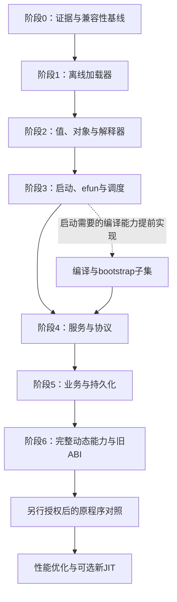

> 阶段 2BO：新增隔离的真实启动探针，五个服务均可执行 Global 初始化 PC 0—24，在 PC 25 停止；唯一实际 efun 为 allocate_array(1024)，下一依赖为 PC 26 的 mkdir。908 项普通 Rust 测试及 5 项 doctest 在 debug/release 通过。初始化完成与服务启动仍未宣称。详见 [启动切片总览](stage2bo-startup-probe/overview.md)及 [验证收据](stage2bo-validation.json)。

> 阶段 2BN：完成六类双事务交错审计：83,832 条核心、84,720 条状态干扰、64 条存活期、24 条元数据、677 条借用及 37,303 条失败点和对照在 debug/release 通过；1,640 条正常库场景覆盖十种公开组合，未发现新的生产偏差。892 项普通 Rust 测试及 5 项 doctest 保持回归。详见 [审计总览](stage2bn-pair-audit/overview.md)及 [验证收据](stage2bn-validation.json)。

> 阶段 2BM：完成对象状态转换与已准备事务交错审计：255,924 条核心、41,656 条定向、357 条借用、54,012 条失败点及对照、6 条元数据和 5,248 条正常库场景在 debug/release 通过，未发现新的生产偏差。878 项普通 Rust 测试及 5 项 doctest 回归通过；运行时/API、旧模型和捕获门槛保持。详见 [审计总览](stage2bm-interleaving-audit/overview.md)及 [验证收据](stage2bm-validation.json)。

> 阶段 2BL：完成占用目的槽替换审计：238,736 条核心 trace、29 条借用、3,515 条失败点及对照、2,624 条正常库场景在 debug/release 通过，未发现新的生产偏差。869 项普通 Rust 测试及 5 项 doctest 回归通过；运行时/API、旧模型和捕获门槛保持。详见 [审计总览](stage2bl-replacement-audit/overview.md)及 [验证收据](stage2bl-validation.json)。

> 阶段 2BK：完成生产组合有界审计：84,108 条批处理、11,736 条公开/内部组合及 1,154 条失败点回放在 debug/release 通过，未复现新的生产偏差。863 项普通 Rust 测试及 5 项 doctest 通过；运行时/API、旧模型和捕获门槛保持。详见 [审计总览](stage2bk-combination-audit/overview.md)及 [验证收据](stage2bk-validation.json)。

> 阶段 2BJ：完成 D08 生产契约差分审计，修复失效 creator 的 Function 预发布和 Mapping 循环输出 origin 两项偏差。2,592 条核心 trace、972 条正常库镜像在 debug/release 通过；857 项普通 Rust 测试及 5 项 doctest 保持回归，公共 API、旧模型和捕获门槛不变。详见 [审计总览](stage2bj-contract-audit/overview.md)及 [验证收据](stage2bj-validation.json)。

> 阶段 2BI：已将 D08 受限生命周期接入正常 Rust 库，增补显式配额构造器及 store/VM 分预算维护 API；legacy 构造、准备权限、版本与依赖保持。851 项普通 Rust 测试及 5 项 doctest 在 debug/release 通过，旧模型和证据冻结，直接捕获与阶段2门槛仍未开放。详见 [生产接入总览](stage2bi-production-lifecycle/overview.md)及 [验证收据](stage2bi-validation.json)。

> 阶段 2BH：已交付生产生命周期 D08 契约与独立配额模型，明确五项显式配额、峰值预留、Host raw 传输及分预算维护进度；仅设计，Rust 运行时/API、旧模型及捕获门禁不变。39 项模型案例、112 项算术检查与完整回归通过。详见 [契约总览](stage2bh-production-contract/overview.md)及 [验证收据](stage2bh-validation.json)。

> 阶段 2BG：已接入 Host Function 创建、捕获和间接调用的生命周期测试，覆盖 creator、回调事务和最终释放；生产运行时/API 与准备门禁不变。详见 [Host Function 测试总览](stage2bg-host-function-test/overview.md)。

> 阶段 2BF：已接入托管初始化、多层构造与失败回滚的生命周期测试，覆盖真实帧租约、参数所有权及显式清理队列；生产运行时/API 和捕获门禁不变。详见 [托管测试总览](stage2bf-managed-test/overview.md)。

> 阶段 2BE：已接入真实 Host 根、直接同步回调及关闭存储保活的测试模式，完成逐检查点回放；生产运行时/API 与捕获门禁不变。详见 [Host 测试总览](stage2be-host-test/overview.md)。

> 阶段 2BD：已交付真实 ObjectStore 与 VM 帧生命周期的测试接入，覆盖执行租约、延迟删除及显式 drain/reap；生产运行时/API 和捕获门禁不变。详见 [测试总览](stage2bd-runtime-test/overview.md)。

> 阶段 2BC：已交付真实值槽、Function 与受限容器图的测试适配；生产运行时/API 和捕获门禁不变。历史 Python 验收在固定基线副本运行。详见 [适配总览](stage2bc-adapter/overview.md)。

> 阶段 2BB：已交付隔离 Rust 生命周期内核及全转换差分回放；仅测试目标编译，现有运行时/API 与捕获门禁不变。详见 [内核总览](stage2bb-kernel/overview.md)。

> 阶段 2BA：已交付受限生命周期 D01 设计、独立模型与有界枚举；仅设计，Rust 运行时/API 与直接捕获门禁不变。原生未发布 H/A 最终清理仍未知。详见 [设计总览](stage2ba-design/overview.md)。

# 最新进度：阶段2AZ

阶段2AZ完成[H/A保存与处置追踪](stage2az-evidence/r01-paths.md)、[外部引用接点分类](stage2az-evidence/r02-classification.md)及[数据引用核验](stage2az-evidence/data-references.json)。新增9条函数dossier和5条xref，复用76条函数记录；保留273A/54F/94C前缀，当前351A/66F/115C及94项历史映射。物理页free与语义清理、provider CALL kind与实际CALL/JMP、表注册与条件调用分别验收。运行时、公共API、版本、依赖和状态模型不变；没有原程序或业务字节码执行。直接捕获与阶段2仍未完成，详见[门槛](stage2az-evidence/gate-review.md)、[收据](stage2az-validation.json)及[下一步](stage2az-evidence/next-batch.md)。以下完整原文保留为历史快照。

# 最新进度：阶段2AY

阶段2AY完成E01/E02定向静态取证与[门槛重评](stage2ay-evidence/gate-review.md)：8条新增、67条复用记录，保留原180A/40F/71C，当前273A/54F/94C及71项历史映射。有限静态路径支持零捕获满栈失败候选，clear/shutdown各有扫描后条件化排空接点；未发布头最终释放与完整退出进展仍未闭合。运行时、公共API、版本、依赖及原644项普通测试/2项doctest保持，没有原程序或业务字节码执行、新状态模型或捕获能力开放。见[本批说明](stage2ay-evidence/overview.md)、[2AY收据](stage2ay-validation.json)与[后续定向任务](stage2ay-evidence/next-batch.md)。以下完整原文保留为历史快照。

# 最新进度：阶段2AX

阶段2AX已补齐既有8条新增、57条复用原生静态记录的[证据总账](stage2ax-evidence/findings.md)、51项历史案例映射与[T05门控规格](stage2ax-evidence/runtime-design.md)。Rust运行时、公共API、版本及依赖保持2AW基线；原644项普通测试与2项doctest保持，验证见[2AX收据](stage2ax-validation.json)。直接Object/Function捕获仍阻塞，阶段2未完成；下一批为[T05-lifecycle-contract-evidence](stage2ax-evidence/next-batch.md)，先补未发布头与最终PCB清理后的安全点等生命周期证据。没有执行参考程序或业务字节码，未新增独立状态模型；语料结果复用冻结2AW记录。以下完整原文保留为历史快照。

# magic_Linux32 Rust 重写实施路线图

阶段2AW已完成 T04 显式受限容器捕获：新增 Object/Global 准备入口，支持无环 Array/Mapping 捕获及私有实际类型 profile 守卫；旧入口仍只接受标量捕获。原626项场景与断言保留，API 仅增补入口，版本与依赖不变。受限容器能力就绪，直接 Object/Function 捕获仍阻塞，阶段2未完成。见[实现说明](../docs/stage2aw-evidence/overview.md)与[验证收据](../docs/stage2aw-validation.json)。下一批为 T05 前置原生契约取证。以下为历史快照。


阶段2AV已完成[T03拟提交图验证](stage2av-evidence/overview.md)：遍历Function捕获边，按最终边拒环并校验共享DAG、存活祖先和资源限额；公共API、版本及依赖不变。保留原606项场景与全部原断言，Host失败原子性及快照契约不变。验证见[2AV收据](stage2av-validation.json)。非标量捕获仍关闭，阶段2未完成；下一批为T04显式受限容器捕获入口。以下为历史快照。


阶段2AU已完成[T02稳定捕获槽与COPY事务](stage2au-evidence/overview.md)：真实源槽规范化、语义Owner唯一/共享展开、raw返回与完成槽转移；公共API、版本及依赖不变。原577项场景保留，仅按冻结证据调整两处预期。Host回调失败仍保持操作数与PC，副作用不回滚、不重放。验证见[新收据](stage2au-validation.json)。非标量捕获仍关闭，阶段2未完成；下一批为T03投影图验证。以下为历史快照。


阶段2AT已完成[宿主/观察边界与语义所有者迁移](stage2at-evidence/overview.md)：公共 API 源码不兼容，改用 ValueInput、不可 Clone 的 HostValue、冻结快照与借用回调。原558项断言保留，新增19项普通测试与2项文档编译负例；577项普通测试及2项doctest通过。版本和依赖不变，非标量捕获仍关闭，阶段2未完成。下一批为2AS T02稳定捕获槽与源COPY计划。验证见[2AT收据](stage2at-validation.json)。以下为历史快照。


**阶段2AS当前交付：**[所有权/源复制设计与独立模型](stage2as-design/overview.md)已完成；锁定Snapshot/HostValue、稳定捕获槽、COPY事务及Function捕获图契约，见[API迁移](stage2as-design/api-contract.md)与[实施任务](stage2as-design/implementation-plan.md)。下一批2AT先实施公共边界和语义持有者迁移，T02/T03后才考虑受限容器捕获；直接Object/Function及完整GC/生命周期仍阻塞。Rust/API/依赖及558项Rust测试保持不变，阶段2未完成。见[验证记录](stage2as-validation.json)。以下保留历史快照。

**阶段2AR当前进展：**复制源规范化与捕获所有权静态取证完成，见[语义报告](vm-capture-ownership-semantics.md)、[问题状态](stage2ar-evidence/questions.md)、[后续Rust规格](stage2ar-evidence/runtime-design.md)及[验证记录](stage2ar-validation.json)。确认17 raw move、05唯一/共享分支、copy源清理与Array/Mapping最后header差异；无catch/其他线程/未发布头及完整GC仍有未知。下一批2AS先闭合所有权/源复制/捕获图设计，暂不放宽非标量捕获；558项Rust测试及运行时/API/依赖不变，阶段2未完成。以下保留历史快照。

**阶段2AQ当前审计：**以2AP为基线重核75行opcode、24项缺口及13类门槛；558项Rust测试与运行时/API/依赖不变，阶段2未完成。见[完成度报告](stage2-completion-assessment-2aq.md)及[当前矩阵](stage2aq-evidence/matrix.md)。下一批优先进行[2AR复制源规范化与非标量捕获所有权取证](stage2aq-evidence/next-batch.md)，其次为继承布局/能力组合、一般异常/主动删除。以下保留历史快照。

**当前阶段2AP：**已实现2AN第二批受限同步Host/K函数值，组合入口同时开启直接06、对象/Global字节码函数值、Global/c和Host/K。函数值保存槽号，每次调用读取当前Host注册与签名；调用上下文来自05调用者，回调仅执行一次，验证成功后才提交VM栈和PC。见[Host/K运行时说明](vm-host-function-value-runtime.md)、[能力增量](stage2ap-evidence/matrix.md)及[验证记录](stage2ap-validation.json)。75种限定支持/73种交集不变。真实efun、异步/重入、非标量捕获、热编译／卸载及完整生命周期组合仍排除；G12/G18与阶段2未完成。以下为历史快照。

**当前阶段2AN：**Global／efun函数值定向取证与[两批实施规格](stage2an-evidence/function-runtime-design.md)完成；见[语义报告](vm-global-function-value-semantics.md)、[接入审计](stage2an-evidence/runtime-design-audit.md)和[验证记录](stage2an-validation.json)。确认Global/c保存代码与当前constitution的组合、Global/K经描述符编号再查表及独立creator owner；首批规格限制Global绑定变化，第二批显式同步宿主采用每次调用解析当前注册。独立复算5,012处全局创建位置、30个静态／设计案例；515项Rust测试debug/release、23项Python检查及fmt/clippy通过。运行时/API/依赖及75种限定支持/73种交集不变，Global／efun函数值尚未开放，G12/G18和阶段2未完成。下一步实施第一批标量捕获Global/c；非标量捕获、真实efun及服务仍排除。以下为历史快照。

**当前阶段2AM：**按2AL规格实现普通函数Int/Bytes Mapping997及私有原生桶链，保留公开entries顺序与成员Cell身份，支持实时修改、输出Array3别名复用及现有调用/预算/清理契约。见[运行时说明](vm-mapping-runtime.md)、[能力增量](stage2am-evidence/matrix.md)及[验证记录](stage2am-validation.json)。515项Rust测试debug/release、19项Python检查及fmt/clippy通过；75种限定支持/73种交集不变。G05仅部分实现，删除后引用、其他键/属性、交叉别名与完整GC仍需后续证据；生命周期循环和真实efun未开放，阶段2未完成。以下为历史快照。

**当前阶段2AL：**Int/Bytes Mapping桶链与遍历修改静态取证完成，见[语义报告](vm-mapping-iteration-semantics.md)、[下一批实施规格](stage2al-evidence/mapping-runtime-design.md)及[验证记录](stage2al-validation.json)。普通函数Mapping997仍未实现；下一批按原生哈希、空桶扩容预算、bucket/subindex/ordinal游标和三元数组别名语义接入。保留其他键/属性、删除后引用、交叉图与生命周期限制，G05仍未关闭。本轮运行时/API/依赖不变，28项Python检查、487项Rust测试debug/release及fmt/clippy通过，75种限定支持/73种交集不变。以下2AJ及更早条目保持历史快照；最新运行时为2AK受限Bytes `+=`。

**当前阶段2AJ：**按2AI规格实现受限Bytes拼接与比较，482项Rust测试在debug/release通过。见[运行时说明](vm-bytes-runtime.md)、[能力增量矩阵](stage2aj-evidence/matrix.md)及[验证记录](stage2aj-validation.json)。75种限定操作码/73种主语料交集不变；G01与阶段2未完成，后续继续非数值运算、Mapping遍历及能力组合缺口。以下为历史快照。

**当前阶段2AI：**Bytes比较/拼接静态取证与实施设计完成，新增12条/复用15条完整记录、125,747处位置复算及56条静态/设计期望。见[语义报告](vm-bytes-semantics.md)、[实施规格](stage2ai-evidence/bytes-runtime-design.md)和[验证记录](stage2ai-validation.json)。下一批实施普通函数Bytes+Bytes/Int、全长相等及首NUL排序；Real拼接、Buffer、复合赋值及生命周期新分支仍排除。本批运行时/API/依赖不变，473项Rust测试、75种限定支持/73种交集，阶段2未完成。以下保留历史快照。

**当前阶段2AH：**完成2AG源码/测试/证据重审，仍为473项Rust测试、75种限定支持/73种语料交集，阶段2未完成。新[完成度报告](stage2-completion-assessment-2ah.md)、[能力门槛](stage2ah-evidence/capabilities.md)与[当前矩阵](stage2ah-evidence/matrix.md)登记24项缺口，其中19项属阶段2、5项明确归后续阶段。下一批唯一首选为[2AI Bytes比较/拼接定向取证](stage2ah-evidence/next-batch.md)；其次Mapping顺序/遍历、函数值/能力组合、一般故障/主动删除。运行时/API/依赖保持不变，未新增反编译或原程序执行。以下为历史快照。

**阶段2AG历史交付：**按2AF规格实现受限Object函数值05/17，支持标量捕获、Rc身份、显式能力入口、跨Object/Global调用者与既有数值catch。473项Rust测试通过，共75种限定支持/73种语料交集；见[运行时说明](vm-function-value-runtime.md)、[当前矩阵](stage2ag-evidence/matrix.md)及[验证记录](stage2ag-validation.json)。非标量捕获、Global/efun/string/OS目标、Buffer/范围写入、完整异常/生命周期和真实efun/bootstrap/调度仍有缺口，阶段2未完成。下一步先按当前矩阵的排除路径梳理阶段2退出条件，再选择取证和实施批次。以下为历史快照。

**阶段2AF历史交付：**函数值05/17已完成静态取证、35,703处位置复算与[首批Object函数值/标量捕获实施规格](stage2af-evidence/function-runtime-design.md)，运行时尚未实现。见[语义报告](vm-function-value-semantics.md)与[验证记录](stage2af-validation.json)。运行时基线为2AE的同步合成06、433项Rust测试、73种限定支持/71种语料交集；真实efun、global/init/bootstrap、完整函数值和服务启动仍有缺口，阶段2未完成。以下2AC及更早条目保留历史状态。

**阶段2AC新增交付：**受限Global函数准备/绑定、全局位07与双上下文帧已实现，支持对象/全局代码切换、引用转发及两向数值catch；407项Rust测试、72种限定操作码、语料交集70种，缺05/06/17。见[全局调用运行时](vm-global-call-runtime.md)、[当前矩阵](stage2ac-evidence/matrix.md)及[验证记录](stage2ac-validation.json)。06、Global init、真实13槽bootstrap与服务启动仍排除。以下阶段描述保留历史状态。

**阶段2AB新增交付：**显式全局表、35/36及强引用保留语义已实现，共72种限定操作码、384项Rust测试；主语料交集70种，缺05/06/17。见[全局运行时](vm-global-runtime.md)、[当前矩阵](stage2ab-evidence/matrix.md)及[验证记录](stage2ab-validation.json)。全局07/06、Global程序加载和真实启动仍未实现，下一批为阶段2AA规格中的双上下文全局调用。以下阶段条目保留历史状态。

**阶段2AA新增交付：**全局35/36、全局07与06边界取证、47,003处全局操作位置及五个全局单元清单已完成，见[全局语义](vm-global-semantics.md)和[后续实施规格](stage2aa-evidence/global-runtime-design.md)。本轮运行时/API/依赖保持不变，继续使用2Z的70种限定操作码基线。下一批仅实现显式合成银行与35/36，保留旧根引用到旧槽；之后独立迁移全局帧与07，不开放真实bootstrap/efun。

**阶段2Z历史基线：**实现10的普通函数直接槽引用检查，共70种限定操作码、359项Rust测试；主语料交集68种，缺05/06/17/35/36。见[引用类型检查](vm-reference-type-check-runtime.md)与[2Z历史矩阵](stage2z-evidence/matrix.md)。动态索引11、生命周期及默认表达式检查仍排除，引用目标不会被解引用或规范化。以下2Y及更早条目保留当时状态，阶段2尚未完成。

**阶段2Y历史基线：**按2X规格实现普通函数Bytes/Array范围查询45，共69种限定操作码、344项Rust测试；主语料交集67种，缺05/06/10/17/35/36。见[范围运行时](vm-range-runtime.md)及[2Y矩阵](stage2y-evidence/matrix.md)。Buffer、生命周期/默认表达式范围执行与完整错误捕获仍受限；阶段2尚未完成。以下2X及更早条目保留当时交付范围。

**阶段2X新增交付：**范围查询 `45` 的静态语义、3,452处语料统计及下一批受限 Bytes/Array 实现规格已完成，见[范围查询设计](vm-range-semantics.md)。本批未修改运行时、API或依赖；68种限定操作码与阶段2W矩阵继续作为实现基线。下一批按该规格实现只读范围查询，Buffer与范围写入不纳入该批。

本文采用“总体方案 → 分阶段实施 → 验收与风险”的总—分结构，面向后续实现兼容运行时的工程师。依据截至 2026-10-13 的 [静态分析](magic_Linux32-static-analysis.md) 与 [服务包兼容性分析](magic_Linux32-rust-compatibility-analysis.md)。本文是实施方案，不表示 Rust 服务端已经实现或原程序已经运行验证。

**阶段2W历史基线：**已扩展19实数/混合除零、28整数余数零及2f选择器5/11对应数值错误捕获，68种限定操作码、323项Rust测试；主语料交集66种、缺7种。见[数值错误捕获](vm-numeric-catch-runtime.md)与[2W矩阵](stage2w-evidence/matrix.md)。整数MIN/-1、引用/类型/配额等错误继续不可捕获，生命周期、宿主回调/JIT/线程仍在范围外。阶段2未完成；后续推进值/范围与引用类型、函数值、Mapping顺序、完整生命周期及全局/宿主契约。

**阶段2V历史基线：**普通函数已支持受限2c/1a/0e与19整数除零路由，68种限定操作码、303项Rust测试；主语料交集66种、缺7种。见[catch运行时](vm-catch-runtime.md)与[当前矩阵](stage2v-evidence/matrix.md)。生命周期内catch、其他错误来源及回调/JIT仍拒绝，阶段2未完成。后续逐项补错误来源证据与测试，再推进值/范围、Mapping顺序、完整生命周期及全局/宿主契约；以下条目保留历史范围。

**阶段2U历史静态进展：**完成通用catch的REA/Ghidra静态取证、语料统计和Rust栈展开设计，见[catch语义与设计](vm-catch-semantics.md)。运行时仍为阶段2T的65种限定操作码、278项Rust测试；主语料交集63种、缺10种。下一实现批次先加入普通函数的受限2c/1a/0e及整数除零来源路由，按两阶段展开、引用租约与循环控制槽清理规格验收；生命周期内catch、其他错误来源及回调/JIT继续拒绝。随后推进值/范围、Mapping顺序及完整生命周期、全局/宿主契约。阶段2未完成，编号比例不代表功能完成率。

**阶段2T历史基线：**已实现隐藏控制Cell载荷、23/12/50的±1整数闭区间与Array路径，65种限定操作码、278项Rust测试；主语料交集63种、缺10种。见[循环运行时](vm-loop-runtime.md)与[当前矩阵](stage2t-evidence/matrix.md)。Mapping哈希顺序、额外源属性、复杂绑定、任务内循环及通用catch仍有限制。以下条目保留其历史范围与测试数。

**阶段2S历史基线：**已实现受限0a/0b/0c，62种限定操作码、254项Rust测试；主语料交集60种、缺13种。见[switch运行时](vm-switch-runtime.md)与[当前矩阵](stage2s-evidence/matrix.md)。阶段2仍未完成；下一批先处理隐藏Cell载荷及整数/数组循环，mapping等待原生哈希顺序兼容，随后推进值/范围、通用catch及对象生命周期、全局/宿主契约。以下阶段条目保留其历史范围与测试数。

**阶段2R历史静态进展：**已取得0a/0b/0c与23/12/50及辅助函数的Ghidra证据，确认case固定metadata对、±1整数闭区间及997集合循环、隐藏控制槽与header清理。见[控制流语义与下一批设计](vm-control-flow-semantics.md)。运行时继续为59种限定操作码、237项Rust测试；下一实现批次先补switch三条，再设计隐藏Cell载荷并补整数/数组循环，mapping等待原生哈希顺序兼容证据。既有2P/2Q快照保持冻结。

**阶段2Q历史基线：**已实现受限08跨对象调用、41 thisObject及显式方法目录，59种限定操作码、237项Rust测试；主语料交集57种、缺16种。见[跨对象调用运行时](vm-cross-object-runtime.md)与[当前矩阵](stage2q-evidence/matrix.md)。阶段2仍未完成，字符串/数组目标、原生命名表、函数值、全局和完整异常/生命周期尚有缺口。后续先补控制流，再推进值/buffer/范围、通用catch和对象生命周期及全局/宿主契约。

**阶段 2P 历史基线（2026-10-14）：**阶段2尚未完成；保持57种限定操作码、212项Rust测试。主语料73种中交集55种，缺18种，另有合成路径4d/4e；编号比例不代表整体完成率。见[完成度评估](stage2-completion-assessment.md)、[逐指令矩阵](stage2-completion-evidence/matrix.md)和[跨对象调用下一批设计](stage2-completion-evidence/cross-object-design.md)。后续依次补调用、控制流、值/buffer/范围/循环、通用catch及完整生命周期、全局/06宿主契约，再进入阶段3实际efun/bootstrap/调度。以下2A—2O条目保留各历史阶段的实现范围及当时测试数。

**实施进度：**阶段 1 离线加载器见 [阶段 1 文档](rust-offline-loader.md)；阶段 2A 的值模型、对象存储和 28 种指令限定路径见 [VM 核心语义](vm-core-semantics.md)。完整解释器、调度和服务端仍未完成。

阶段 2O 已实现显式生命周期绑定、完整初始化后的顺序create、失败时逆序destruct回滚及局部错误恢复；保持57种限定操作码，212项Rust测试通过。见[构造运行时](vm-construction-runtime.md)。主动析构、全局catch和调度器延迟删除仍未开放。

阶段 2N 已实现按需准备的对象初始化任务、独立初始化帧、2e/48、预算暂停及失败清理，共57种限定操作码、191项Rust测试。见[初始化运行时](vm-initialization-runtime.md)。初始化成功不代表构造完成；create/destruct和局部异常恢复继续留待后续。

阶段 2M 已完成对象生命周期静态分析：确认先全层初始化、再全层create、逆序destruct，以及失败回滚和延迟删除边界。见[生命周期分析与后续设计](vm-object-lifecycle.md)。本轮没有修改运行时；下一实现批次先补独立初始化代码体、2e/48与预算任务，构造/析构待局部异常恢复另行实现。

阶段 2L 已实现显式依赖目录、无共同祖先的继承链接、声明绑定及调用/变量/字符串池上下文切换；仍为55种限定指令路径。见[继承运行时](vm-inheritance-runtime.md)与[阶段2K静态证据](vm-inheritance-linking.md)。验证只使用合成程序，未执行原版或业务字节码。

阶段 2J 已实现可选mixed、线性默认表达式及可变参数，新增47/34/15，共55种限定指令路径，150项测试通过。实现范围与接口迁移见[默认参数运行时](vm-optional-arguments-runtime.md)，依据见[阶段2I静态分析](vm-optional-arguments.md)。全量检查只验证加载结构，不代表业务程序执行覆盖。

阶段 2H 已实现当前对象内固定函数的引用参数、嵌套转发和原子入口检查；仍为 52 种限定指令路径，132 项合成/加载器测试通过。接口、兼容差异和限制见 [引用参数运行时](vm-reference-arguments-runtime.md)；原生证据与静态统计见 [阶段 2G](vm-reference-arguments.md)。这不表示 3,050 个静态形状候选函数已经能够执行。

阶段 2F 已实现数值自增减与十种数值复合赋值，共 52 种限定指令路径；见 [数值更新语义](vm-numeric-updates.md)。

阶段 2E 已完成稳定值槽、引用与成员标量写入，共 50 种限定指令路径；API 迁移和限制见 [受限引用运行时](vm-reference-runtime.md)。阶段 2D 的原始证据与设计见 [引用静态分析](vm-reference-semantics.md)。

阶段 2C 已实现不可变数组和普通映射，共 43 种限定指令路径；见 [容器语义文档](vm-container-semantics.md)。

阶段 2B 已扩展至 39 种限定指令路径，实数、数值转换与位运算的证据和限制见 [数值语义文档](vm-numeric-semantics.md)。执行验证仍限人工构造程序。

## 一、总体方案

### 1.1 目标与边界

以 Rust 重写原生驱动，直接加载现有 PAK 和 `.o`，逐步保留脚本语义、启动配置、客户端协议、服务间通信和持久化行为。业务字节码继续作为业务实现来源，不先将全部业务函数翻译成 Rust。

首期兼容主驱动的 `Magic559` ABI；`1/driver` 对应的 `LegacyAuth389` 是独立兼容目标。主服务的 AAA 账户认证与旧驱动认证设施应分别建模。初期保留旧认证服务的接口边界，完整 Rust 替代阶段再实现旧 ABI；这不是启动旧服务的授权。

实施以解释器为主线：先证明语义与接口兼容，再优化性能。暂不移植与 x86 宿主绑定的旧 JIT。不因已有 `.o` 就删除编译器：资源中实际存在 `compile_program`、`execute_data` 调用，内嵌脚本启动也有编译依赖。

路线图初次交付只包含文档；后续实施进度另行标记。原始 ELF、PAK、`.o` 和启动脚本保持不变，不执行原程序、脚本或字节码。原程序运行对照需要另行授权。

原版运行对照环境需提供 `/lib/ld-linux.so.2`、`glibc.i686` 和 `libstdc++.i686`；离线 Rust 工具按宿主架构构建，不继承这两项 32 位运行依赖。

### 1.2 已有基础与证据分级

| 已确认的静态基础 | 实施意义 | 不代表什么 |
|---|---|---|
| 12 个 PAK，9,527 个目录及文件项；8,921 个文件内容成功恢复 | 可建立固定加载器语料 | 不证明所有资源正常，另有 1 个异常文件记录 |
| 7,159 个主 ABI 单元完整结构解码 | 可复用现有业务程序 | 不证明字节码执行等价 |
| 9,933 条继承关系目标与声明计数匹配 | 可验证继承和重定位 | 不证明动态对象加载顺序闭合 |
| 559 个 efun 槽，312 个直接引用的名称 | 编号表可固定，实现可按依赖排序 | 不证明其他槽永远不会调用 |
| 主语料使用 73 种 opcode | 可确定首期解释器覆盖集合 | 不证明所有操作码分支语义已恢复 |
| 旧认证 ABI 的 2 个全局单元可解码 | 可单独建立旧格式测试集 | 不证明任意旧对象或继承格式兼容 |

**事实**须指向原始字节、Ghidra 结果或可复核的静态提取；**设计建议**表示本路线选择；**未知项**进入待验证清单。每个实现任务记录其证据、测试和剩余限制，不能将结构解析成功作为运行兼容结论。

### 1.3 架构与接口

| 模块 | 职责及关键约束 |
|---|---|
| `artifact` | PAK、目录查找、LZSS、虚拟路径；保留名称比较和压缩属性规则 |
| `loader` | 程序格式、字符串映射、继承及重定位；旧指针字段不能成为宿主指针 |
| `value` / `object` | 带标签值、对象身份、共享、复制、析构及方法分派 |
| `vm` | 指令、调用帧、返回值、异常和执行预算 |
| `scheduler` | 协作执行、定时器、等待、挂起和回调恢复 |
| `driver_api` | 固定 efun 编号表、参数约束、配置及启动全局函数 |
| `transport` | 原生封包、动态协议声明、连接与消息队列 |
| `persistence` | 旧序列化格式、数据库结果及外部服务适配 |

以下为拟采用的接口边界，尚未实现；具体字段应由对应阶段的语义证据确定：

```rust
enum AbiProfile { Magic559, LegacyAuth389 }
struct ObjectId(u32);
enum ExecState { Ready, Waiting, Suspended, Finished, Failed }
// load_program(profile, bytes, load_context) -> Result<ProgramImage, LoadError>
// step(object, frame, budget) -> ExecState
// invoke_efun(index, arguments, context) -> Result<Value, VmError>
```

程序映像使用显式索引及受控句柄，ABI 由明确配置选择，不能只凭两套格式共有的 `0x10001` 魔数判定。字符串默认保存原始字节；整数宽度、溢出、浮点转换和端序明确实现，不采用宿主默认行为替代旧 VM 语义。

### 1.4 实施顺序与交付层次



交付分别标记为：**离线资源兼容工具**、**最小主 ABI 运行时**、**指定流程服务兼容版本**、**完整目标兼容版本**。每次发布写明已支持的输入和行为，未通过后续阶段时不使用“完整替代”表述。阶段是依赖顺序，不是未经评估的工期承诺。

## 二、分阶段实施

### 阶段 0：固定证据与兼容性基线

**目标与输入：**以现有输入清单、Ghidra 证据、格式统计及启动配置建立后续验收基准。已有 Python 静态工具属于分析基础，尚不是 Rust 加载器。

**任务：**

- 核对制品哈希和解析统计，保持原始输入只读；派生文件单独保存。
- 为操作码、efun、值语义、动态调用和协议建立证据与实现状态表，状态使用“已确认／待验证／未实现／已测试”。
- 登记数据库 schema 与数据、外部 HTTP 认证契约、AAA→GS 交付协议等缺口；记录缺失的 `dba/dbamem.cfg` 和异常资源，避免静默补造。

**产物与验收：**版本化语料清单、兼容矩阵和未决问题清单。每项确认结论可回到证据；没有真实凭据复制到文档或测试样例。基线固定后进入阶段 1。

### 阶段 1：实现 Rust 离线加载器

**目标与输入：**直接读取原始 12 个 PAK 和主 ABI `.o`，与现有成员清单、程序统计及继承表核对。

**任务：**

- 建立 Cargo 项目：实现放入 `src/`，集成测试放入 `tests/`，小型可复现输入放入 `tests/fixtures/`。
- 实现目录边界、包内绝对偏移、属性位、大小写比较、LZSS 和虚拟路径解析。
- 实现对象／全局单元格式、字符串池、代码节点、metadata、符号和继承记录；拒绝截断、越界及无效引用。
- 分离解析结果与运行状态，不反序列化宿主指针；记录严格格式检查与旧驱动行为的差异。

**产物与验收：**离线检查工具、结构化程序映像及错误报告。12 包枚举结果与基线一致，7,159 个主单元完整消费至 EOF，9,933 条继承目标和计数匹配；可恢复成员内容哈希一致。

已知异常 `dba/pack_data/etc.pak/etc` 必须显式报告，不用空内容冒充成功。旧 ABI 此阶段只要求明确识别为不同配置；其完整支持进入阶段 6。离线兼容通过后进入阶段 2。

### 阶段 2：实现值、对象和解释器核心

**目标与输入：**以主驱动动作表、调用例程和静态程序映像实现主语料实际使用的 73 种操作码。

**任务：**

- 逐项恢复值标签、32 位数值计算、混合类型转换、字符串／buffer 区别、数组和 mapping 行为。
- 建立对象存储、克隆、继承重定位、函数值、调用帧和方法查找；保留 `default_interface` 及缺失方法分支。
- 明确共享引用、复制和销毁规则，包括循环引用；不能把 Rust 所有权直接当作旧 VM 语义。
- 用错误与执行状态实现 catch、返回 hook 和非局部退出，禁止跨 Rust 栈模拟 `longjmp`。

**产物与验收：**可执行人工构造小程序的解释器和操作码语义表。73 种操作码均有实现及针对性测试；算术边界、别名修改、继承调用、异常传播和非法程序失败路径有明确预期。未知语义继续标记，不以任意默认值通过测试。

### 阶段 3：实现 bootstrap、efun 和调度

**目标与输入：**固定 559 项 ABI 注册顺序，重建启动前全局函数及协作执行环境。

**任务：**

- 恢复启动单元所需的 13 个已有全局槽及编号顺序，验证全局基数 572；数量匹配不能替代完整绑定证明。
- 保留全部 559 个 efun 槽，按启动路径和 312 个直接依赖排序实现。未支持调用返回明确的兼容错误，不以无操作或默认成功替代。
- 采用受控 VM 执行队列，验证 FIFO、定时器、线程分派、等待、挂起、重入及连接关闭后的恢复规则；外部 I/O 完成事件返回该队列。
- 先恢复启动所需编译语义。若暂用受控 bootstrap，只作为标有限制的过渡方案，验证编号和可观察接口，不能宣称完整动态编译兼容。

**产物与验收：**efun 支持矩阵、bootstrap 绑定测试和确定性调度测试。选定启动链不触发未实现调用；全局索引、定时事件及挂起恢复可重复。进入阶段 4 前，启动必需的编译能力必须可用或明确限定为过渡测试路径。

### 阶段 4：贯通服务启动和协议

**目标与输入：**复用现有入口与配置，验证 AAA、CCS、DBA、GS、CSA 的启动和通信边界。该列举不是已证明的完整部署启动顺序。

**任务：**

- 按各服务入口逐个恢复启动依赖，建立受控配置、时钟和连接替身；先验证独立链，再组合服务。
- 实现 `MZ` 包头、大端网络字段、校验、扩展长度和增量收包；分别保留不同路径的长度上限。
- 同时实现原生命令索引与动态 packet 声明，覆盖数组、mapping 和回调封装，不能只用固定命令号匹配。
- 验证 GS 启动的 CCS 时间同步、配置覆盖、失败／挂起分支，以及断线、超时和重连事件。

**产物与验收：**启动依赖表、消息布局清单和协议测试样例。分片／合并收包、非法长度、校验失败、未知命令及动态字段编码均有测试；每个服务的受控启动路径有可追踪结果。未恢复的消息和连接契约明确列出。

### 阶段 5：贯通登录、业务和持久化

**目标与输入：**以已恢复的代表业务链验证 VM、调度和外部接口组合行为。

**任务：**

- 验证 AAA 的账户查询、密码处理、保护认证和结果发送；先使用模拟数据库及 HTTP 服务，随后补齐真实契约。
- 验证 GS 的新连接 → `logind.new_user` → 未登录对象 → `process_command` → `threadd` → `do_login` → 数据恢复 → `enter_world`。不得误用已登录状态下的同名 login 命令作为入口。
- 验证 GS `filed` 队列到 DBA 内容创建、读写及 SQL 的完整消息和结果链；保持旧序列化、checksum、字段编码与错误分支。
- 逐步增加 CCS 协作、CSA 流程和 GS 其他业务覆盖，以调用依赖选择下一个样例，不以函数数量作为功能完成度。

**产物与验收：**端到端受控场景、协议交付约定和数据库适配测试。成功登录、拒绝／超时、数据缺失、读写失败和连接中断均验证对象状态、消息及持久化结果。

接入真实依赖前，必须取得数据库 schema、编码、事务和错误契约；已有 SQL 调用不是完整建库依据。指定业务场景通过后，只能称“该流程受控兼容”，不能推及全部业务。

### 阶段 6：补齐动态能力和旧认证 ABI

**目标与输入：**消除阶段性限制，扩展到约定的完整目标能力。

**任务：**

- 完善编译器、`compile_program`、`execute_data`、函数值及其他动态调用路径；覆盖实际需要的语法、错误和源位置行为。
- 补齐完整目标依赖的 efun 和协议分支，审计静态未直接引用但可能动态调用的槽位。
- 单独实现 `LegacyAuth389` 加载器、注册表和解释语义。先验收 `auth_srv.o`、`pwd.o`，若要求其他旧对象，先扩充格式证据和语料。
- 保持认证接口、密钥配置和旧错误语义；密钥不硬编码进源码或测试。

**产物与验收：**完整目标兼容矩阵、两套 ABI 隔离测试及剩余限制清单。已约定的可达路径不能有未实现调用；旧单元按 389 → 402 的全局基数关系加载。仅两个旧单元通过，不标记为任意历史版本兼容。

## 三、验收流程与关键证据

### 3.1 分层验证

| 层次 | 验证方式 | 通过标准 |
|---|---|---|
| 静态语料 | Rust 结果与现有独立提取结果交叉核对 | 内容哈希、结构、索引和继承统计一致，异常不隐藏 |
| VM 单元 | 人工构造最小程序与证据推导的预期 | 核心语义及错误路径确定；不单纯复制实现逻辑作断言 |
| 调度与服务 | 确定性时钟、模拟连接和外部服务 | 状态变化、事件次序、消息字节及错误结果可重复 |
| 原程序对照 | 另行授权后，在隔离兼容环境进行差分 | 记录环境与输入，对照输出、状态、时序及数据结果 |
| 性能与恢复 | 正确性稳定后建立负载和故障场景 | 根据实测要求确定指标，再决定优化或新 JIT |

当前 Cargo 项目使用 `cargo test --locked`、`cargo fmt --check`、`cargo clippy --locked --all-targets -- -D warnings`；阶段2P另有矩阵重算与只读语料校验。每阶段保留可复现测试和限制说明，原程序对照未完成时不得称已证明行为等价。

### 3.2 实施时优先回查的证据

下表为主 ELF 地址；业务字节码附件中的偏移是解压后成员内偏移，二者不能混用。

| 原函数／证据 | 地址或位置 | 对应阶段 |
|---|---|---|
| `fm_readCatalog` / `fm_unpack` | `0x080b51ec` / `0x080b5500` | PAK 和压缩规则 |
| `vm_loadBinary` / `vm_loadCodeSegment` | `0x080b9264` / `0x08096128` | 程序格式与代码加载 |
| `vm_callInOtherFun` | `0x08094cd8` | 对象调用与方法回退 |
| `vm_run` / `vm_doActions` | `0x08098b20` / `0x08097008` | 解释执行 |
| `vm_mainLoop` | `0x080adea8` | 调度与驱动循环 |
| `vm_cmdLogin` | `0x08054da8` | 网络到脚本登录入口 |
| GS 登录、AAA、DBA 链 | [字节码指令附件](compatibility-evidence/bytecode-listings.md) | 代表业务验证 |

格式依据见 [主加载器 Ghidra 证据](compatibility-evidence/main-rea-functions.md)，对象分派见 [分派证据](compatibility-evidence/dispatch-rea-functions.md)，旧认证见 [旧加载器证据](compatibility-evidence/auth-rea-final-functions.md)。固定统计见 [兼容摘要](compatibility-evidence/compatibility-summary.json)、[efun 表](compatibility-evidence/efuns.csv)、[继承表](compatibility-evidence/inheritance.csv) 和 [已有静态检查](compatibility-evidence/validation.json)。分析工具输出可作交叉核对基线，不能替代原始语义证据。

## 四、风险、默认决策与完成定义

| 风险／未知 | 默认处理与退出条件 |
|---|---|
| 值转换、共享、异常和调度语义未全部恢复 | 先补反汇编证据和最小测试，再实现对应路径；不采用猜测的静默行为 |
| 数据库、外部认证及 AAA→GS 协议未闭合 | 先验证替身边界；真实接口具备明确契约后才能验收实际互操作 |
| DBA 内存配置缺失、资源记录异常 | 独立登记；确认缺省行为及访问情况，不擅自修复原包或断言必然启动失败 |
| 动态调用导致静态覆盖不足 | 保留全部 ABI 索引，增加动态解析和可达路径测试，未支持调用明确失败 |
| 旧 ABI 与主 ABI 魔数相同 | 以明确 profile 隔离，错误配置应报告格式不兼容 |
| 没有原程序运行证据 | 静态阶段只陈述静态或受控验证结果；差分测试等待独立授权 |
| 性能目标尚无测量依据 | 不承诺吞吐或固定工期；语义稳定后测量瓶颈，最后评估 JIT |

“完成”指约定输入、配置和业务范围均有实现及验收证据，外部接口和动态能力没有未披露缺口，并完成所要求的互操作／原程序对照。若范围暂限离线工具或指定流程，应按对应交付层次发布，保留下一阶段清单。

默认不选择未经验证的第三方库版本，不建立虚构数据库结构，不将整个旧 C 内存布局搬入 Rust。优先使用可审计的安全 Rust 模块；确需 FFI 或后续 JIT 时，将其隔离为明确边界并单独验证。
