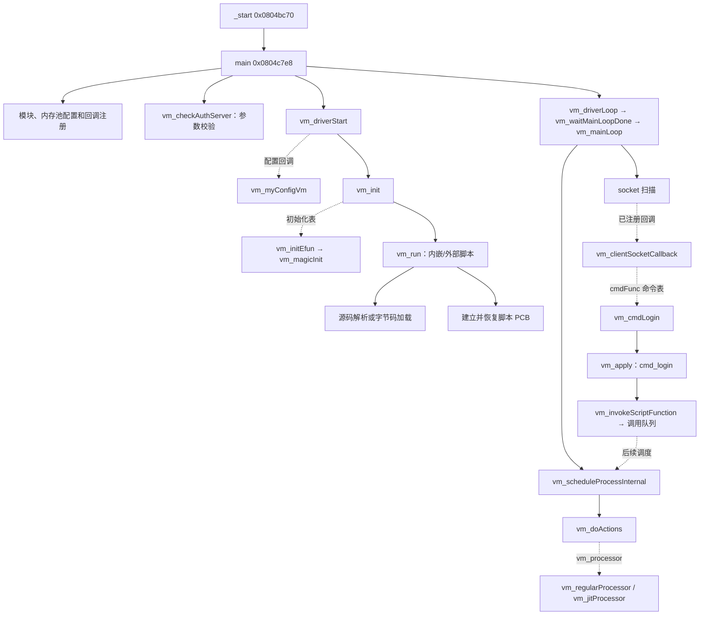

# magic_Linux32 静态逆向分析与 Rust 重写可行性报告

分析日期：2026-10-13。分析引擎：**Ghidra 12.1.4，通过 REA MCP 调用**。

## 1. 结论与证据边界

**确认事实：**该 ELF 实现了 Gameshell 脚本运行环境、编译器、协作式 VM 调度、可选 JIT，以及面向游戏客户端的网络命令分派。`main` 负责启动，`vm_clientSocketCallback` 负责收包及路由，`vm_run` 负责编译/加载脚本，`vm_regularProcessor` 负责解释执行。登录等原生处理函数会把请求转换为脚本函数调用，不能把这些适配函数等同于完整游戏业务实现。

**推测：**结合客户端命令、角色/宠物/交易相关符号及 Gameshell 路径，程序很可能是某款网络游戏的服务端驱动。现有证据不足以确定具体游戏、发行版本、实际部署配置或服务器当前可用性。

**Rust 评估：**分阶段重建协议处理、解释器和服务框架可行；仅凭本样本还不能承诺完整游戏服务或旧部署的行为等价。难点集中在语言语义、外部业务脚本、持久化格式及架构相关 JIT，而不是入口函数本身。

全程没有执行目标二进制、内嵌脚本或生成的机器码，没有连接目标程序所描述的网络服务，没有修改目标。Ghidra 使用独立临时数据库；产物仅为报告、证据与静态提取工具。

证据标记约定：

- **确认事实**：可由文件字节、Ghidra 汇编、交叉引用、反编译或已验证的静态解码支持。
- **推测**：根据上述事实推导的用途、架构归属或重写方案。
- **未知**：静态覆盖不足、缺少外部文件或无法解析的间接目标。

函数链接指向 [完整函数证据与原始伪代码](evidence/functions.md)，其中列出完整 Evidence ID、函数体范围、调用者、被调用者和汇编。[REA 索引](evidence/rea-index.md)包含全部 87 条记录；[压缩原始证据包](evidence/magic_Linux32-rea.json.gz)解压后是未改写的 REA JSON。可读汇总与整理版伪代码不是原始源码。

## 2. 样本身份与文件布局

| 项目 | 确认结果 |
|---|---|
| 文件 | `/Users/ringo/OpenProjects/rml32/magic_Linux32` |
| 大小 | 7,827,072 字节 |
| SHA-256 | `5d4ebac58d8c415d9cf95bbcdd50f78afac91adf4f7e667ea3afc6f5336a6f34` |
| 格式 | ELF32、LSB 小端、`ET_EXEC` |
| CPU | Intel 80386 / x86，ELF `e_machine = 3` |
| ELF 入口 | `_start`，`0x0804bc70` |
| 主函数 | `main`，`0x0804c7e8` |
| 链接方式 | 动态链接，解释器 `/lib/ld-linux.so.2` |
| 符号与调试信息 | 未剥离；含 `.symtab` 和 DWARF 调试节 |
| Ghidra 识别规模 | 8,447 个函数、19,364 个已定义字符串对象 |

函数数是分析数据库的识别结果，包含导入桩、库代码及分析生成函数，不等于业务函数数。字符串计数包含调试/符号空间，不等于用户可见字符串数。辅助 ELF 字节解析识别到 7,759 个有定义的 `STT_FUNC` 符号，两种计数的口径不同。

| 节 | 起始虚拟地址 | 字节数 | 用途 |
|---|---|---:|---|
| `.plt` | `0x0804ae14` | 3,664 | 动态导入跳板 |
| `.text` | `0x0804bc70` | 2,455,296 | 原生代码 |
| `.rodata` | `0x082a33a0` | 1,184,976 | 常量和字符串 |
| `.data` | `0x083c8ba0` | 196,808 | 表、配置、内嵌资源 |
| `.bss` | `0x083f8c80` | 2,571,044 | 全局运行状态 |

地址均为静态链接虚拟地址，不是文件偏移。Ghidra 的 `EXTERNAL` 空间是分析器构造的符号空间，不是目标 ELF 的实际加载节。

基础布局证据：`ev_bc218b7fb1a81fb7ab78196d70d31761a2bc4bcda25a4827820f84ab5eb823e8`；入口符号搜索：`ev_8cada05ba670c5f30f22fac28279a4e9b35046527f40bf7b0db07e38534464bb`。辅助 ELF 字段与依赖列表见 [static-extraction.json](evidence/static-extraction.json)。

## 3. 导入函数、主要符号与关键字符串

### 3.1 动态依赖和导入

ELF 的 `DT_NEEDED` 列出：`libcrypt.so.1`、`libm.so.6`、`libc.so.6`、`libpthread.so.0`、`libstdc++.so.6`、`libdl.so.2`、`libresolv.so.2`、`libgcc_s.so.1`。这是声明依赖，未检查实际宿主是否具备这些库。

Ghidra 导入符号空间有 229 个外部符号；辅助解析的未定义动态符号及绑定类型完整保存在 [elf-imports.csv](evidence/elf-imports.csv)。重要类别如下：

| 类别 | 代表函数 | 已核实使用或限制 |
|---|---|---|
| 启动 | `__libc_start_main` | `_start` 向其传入 `main` |
| 网络 | `socket`、`bind`、`listen`、`accept`、`recvfrom`、`sendto`、`select` | 监听与客户端回调链已分析；不能由导入推定实际监听端口 |
| 文件 | `fopen`、`fread`、`fwrite`、`open64`、`pread64`、`mmap64` | 配置、虚拟文件系统及库代码均可能使用 |
| 并发 | `pthread_create`、互斥量、条件变量、`pthread_join` | VM 同时包含 OS 线程设施和独立的脚本 PCB 调度 |
| JIT | `mprotect` | `vm_jitEnableExecute` 将代码覆盖页设置为权限值 `7` |
| 错误恢复 | `_setjmp`、`longjmp` | 编译器和执行器使用非局部跳转恢复 |
| 扩展 | `dlopen`、`dlsym`、`dlclose` | 存在 ApexProxy 相关线索；本轮未完整分析插件生命周期 |
| 其他 | `system`、`fork`、数学函数、C++ 异常设施 | 导入存在不代表正常流程一定调用 |

SQLite、MySQL 客户端、TinyXML、压缩、字体及数据库相关函数存在于样本内部，不能因为某库未在 `DT_NEEDED` 中出现就认定该能力不存在。SQLite 注册路径和版本字符串已观察；其余库的所有功能没有逐一审计。

### 3.2 核心函数和数据表

| 函数/对象 | 地址 | 职责或证据 |
|---|---|---|
| [`main`](evidence/functions.md#main) | `0x0804c7e8` | 注册、校验、启动、循环、退出 |
| [`vm_checkAuthServer`](evidence/functions.md#vm_checkAuthServer) | `0x0804c454` | 命令行认证配置的 MD5 检查 |
| [`vm_myConfigVm`](evidence/functions.md#vm_myConfigVm) | `0x0804c668` | 样本特定的默认配置 |
| [`vm_magicInit`](evidence/functions.md#vm_magicInit) | `0x0804cc14` | 客户端槽位、命令索引、统计、原生扩展 |
| [`vm_f_start_service_on`](evidence/functions.md#vm_f_start_service_on) | `0x0804e824` | 脚本调用的 TCP 监听设施 |
| [`vm_gameListenSocketCallback`](evidence/functions.md#vm_gameListenSocketCallback) | `0x0804edc0` | 接受连接、绑定客户端、通知脚本 |
| [`vm_clientSocketCallback`](evidence/functions.md#vm_clientSocketCallback) | `0x0804f1dc` | 包状态机、检查、解析和命令分派 |
| [`vm_cmdLogin`](evidence/functions.md#vm_cmdLogin) | `0x08054da8` | 登录字段解析和脚本桥接 |
| [`vm_run`](evidence/functions.md#vm_run) | `0x08098b20` | 编译/加载并建立脚本执行上下文 |
| [`vm_apply`](evidence/functions.md#vm_apply) | `0x0809a328` | 按名称查找脚本/扩展函数 |
| [`vm_scheduleProcessInternal`](evidence/functions.md#vm_scheduleProcessInternal) | `0x080ad1d4` | 定时器、回调队列及 PCB 轮转 |
| [`vm_mainLoop`](evidence/functions.md#vm_mainLoop) | `0x080adea8` | 调度、socket 扫描、Telnet 扫描和等待 |
| [`vm_driverStart`](evidence/functions.md#vm_driverStart) | `0x080ba6b8` | 内存池、配置、参数、VM 初始化 |
| [`vm_init`](evidence/functions.md#vm_init) | `0x080b5ed8` | 初始化表与启动脚本 |
| [`vm_doActions`](evidence/functions.md#vm_doActions) | `0x08097008` | 执行保护、控制状态与处理器间接调用 |
| [`vm_regularProcessor`](evidence/functions.md#vm_regularProcessor) | `0x080978c4` | opcode 表驱动的解释器 |
| [`vm_compileToJit`](evidence/functions.md#vm_compileToJit) | `0x080ca08c` | 生成代码、建立指令地址映射 |
| [`vm_yyparse`](evidence/functions.md#vm_yyparse) | `0x080ffa64` | 大型语法分析函数 |
| `_cmdList` | `0x083c8e60` | 924 槽：923 条非空记录加终止记录 |
| `_serverCmdList` | `0x083c8e40` | 2 条非空记录后遇到终止记录 |
| `actionInfoTable` | `0x083cc680` | 87 个 28 字节槽，包含无效/哨兵项 |
| `_vmInits` | `0x083cf960` | 25 条 16 字节初始化记录 |
| `_builtInFiles` | `0x083ce680` | 16 槽中首 3 个为内嵌脚本 |

完整数据表见 [commands.csv](evidence/commands.csv)、[actions.csv](evidence/actions.csv)、[initializers.csv](evidence/initializers.csv)。923 是记录数，存在命令别名及重复编号，不能直接称为 923 种独立业务。

### 3.3 与代码关联的字符串

| 地址 | 字符串 | 代码证据 |
|---|---|---|
| `0x082a3487` | `/v/auth_1980.c` | `vm_myConfigVm` 指定基础脚本；该常量以数据引用定位，不仅依赖字符串搜索 |
| `0x082a43f1` | `cmd_login` | xref `0x08054f36`；随后 `0x08054f43` 调用 `vm_apply` |
| `0x082a3a90` | `cmd_new_connection` | 监听回调接受连接后向脚本发出通知 |
| `0x082a36f8` | `start_service_on` | 原生扩展名称与对应监听实现 |
| `0x082a3541` | `INIT_SOCKET_SCANNER_TEMP` | `main` 特殊参数路径，加入两个负值扫描条目 |
| `0x082b2503` | `--to-compile` | `vm_driverStart` 的编译模式分支 |
| `0x082a342e` | `%s/pack_data/etc.pak` | `vm_checkLocalOptions` 构造资源包路径 |
| `0x082c84c0` | `@(#) $Id: SQLite version 3.3.1 $` | 版本常量；不是整个程序版本 |

`cmd_login` 的独立 xref 证据：`ev_e150b27174084a178ddb0ffd436fb9b7ebce73cc6ae8c056a467eb056e552da9`。源码路径中的 `gameshell`、`G-BITS` 是构建来源线索，不足以独立证明产品身份。

## 4. 工作流程与函数调用关系

下面是经函数 dossier、回调注册和数据表补齐的关键路径。实线表示直接调用或代码内处理；虚线表示注册后的间接调用/按名称查找。它是业务骨架，不是完整程序 CFG。



### 4.1 启动与退出

`_start` 调用 libc 启动设施并传递 `main`。`main` 的汇编明确包含：`0x0804c8a6 → vm_checkAuthServer`、`0x0804c8c4 → vm_driverStart`、`0x0804c8fe → vm_driverLoop`、`0x0804c903 → vm_driverStop`。配置或启动失败返回 `-1`，正常退出返回 `vm_getReturnValue()`。

`vm_registerConfigRoutine` 把 `vm_myConfigVm` 注册为配置回调，所以 `vm_driverStart` 的“无回调通用默认值”不能冒充本样本的默认配置。本样本回调设置基础认证脚本、RPC 认证和连接上限、根目录 `./`、Telnet 端口 `0`、密码字符串 `denied`、关闭自动接受；后续参数解析仍可改变配置。

`vm_init` 依次调用 25 项初始化表以及已注册模块，再尝试加载 `/v/telnet_shell.c`、基础脚本和启动脚本。`/v/` 是内嵌文件命名空间：`vm_open` 去掉前缀后调用 `vm_builtInFileOpen`，不是对宿主根目录 `/v` 的直接读取。

`vm_driverLoop` 在 `_quitAfterCompiled` 置位时直接返回；否则可创建命令行任务并进入 `vm_waitMainLoopDone → vm_mainLoop`。这里的主循环是在调用任务中进入，不应误写成“必然创建独立主循环线程”。

### 4.2 编译、加载和执行

`vm_startNewFile` 根据配置的二进制后缀区分两条路径：源码经词法预处理、`vm_yyparse`、XAction 优化和 `vm_transformXActions`；二进制经 `vm_loadBinary`。后者检查 `0x10001` 标识、函数编号基数 `vm_functionBC`、字符串/标识符表及结束 opcode `0x1d`，说明字节码加载依赖已有程序状态，不只是独立的指令数组读取。

`vm_transformXActions` 为每个 VM 节点分配 4 字节，并建立可选符号和独立 metadata。`vm_run` 建立 PCB、设置优先级、恢复进程并唤醒主循环；没有结束 hook 时还等待执行结束。其 `fileFd == 0` 判断针对 VM 内部描述符，不应套用为“操作系统 fd 0 一定非法”。

`vm_yyparse` 中存在 `yyr2` 等解析表、归约分支、`yylex` 和动作生成调用，支持“生成式语法分析器”的判断。但本轮没有恢复完整语法规范；337,817 字符的伪代码保存在附件，不声称每个归约分支已审计。

### 4.3 网络与业务分派

`vm_f_start_service_on` 从脚本参数取得端口，建立 AF_INET / SOCK_STREAM socket、绑定所有本地地址、设为非阻塞、以 `0x838` 为 backlog 调用 `listen`，注册监听回调。**未知：**实际游戏服务端口和调用时机取决于脚本/配置。

监听回调接受连接、取得空闲客户端槽、通过 `vm_bindToClient` 注册接收回调，并调用脚本 `cmd_new_connection`。客户端接收回调维护同步/头部/正文状态、按不同客户端类型限定每轮处理量，并在异常时重新同步或断开连接。

完整包首先进入 `vm_pktAnalyse`；只有其返回值不为 `1` 时才走原生命令索引回退。因此不能把全部请求都描述为直接进入 `_cmdIndex`。回退路径验证命令存在、类型位允许，并对移动客户端检查 214 项允许列表，然后在 **`0x0804f5c3`** 执行 `CALL [ECX+4]`。

命令表记录 `0x083c9280`、`0x083c9288` 分别把 **`0x4124` 和 `0x1002`** 映射至 `vm_cmdLogin`，类型为 `1`。其正常字段顺序为账户短字符串、32 位 authKey、32 位 seed、版本字符串、客户端类型、key 和 computer_id；短字符串以单字节长度表示，整数经字节交换读取。函数还存在缺省版本和短包分支，详见原始伪代码，不能只按正常布局重建全部兼容行为。

成功解析后，`vm_cmdLogin` 向 `vm_apply` 传入 `cmd_login` 和 8 个类型化参数。`vm_apply` 在全局程序中查找名称，再调用 `vm_invokeScriptFunction`；该入口使用 `spawnThread=0`，向调用队列添加值。**确认：**桥接目标与排队方式存在。**未知：**账户校验、角色创建和登录授权的完整脚本实现，不能由原生适配函数推定。

## 5. 包格式、校验和及执行语义

### 5.1 网络包布局

Ghidra 恢复的 `Vm_Packet_Header` 大小为 12 字节；实际网络前缀为 10 字节，命令号属于 `msgLen` 所计的数据前两个字节。

| 偏移 | 宽度 | 字段 | 确认语义 |
|---:|---:|---|---|
| 0 | 2 | `Code` | 字节 `4d 5a`，即 `MZ`；x86 字比较为 `0x5a4d` |
| 2 | 2 | `checkSum` | 接收时按大端解释；属性 `0x200` 且字段非零才验证 |
| 4 | 4 | `tickCount` | 一般为零/时钟；扩展长度包复用为大端长度 |
| 8 | 2 | `msgLen` | 大端；`0xffff` 是扩展长度标志 |
| 10 | 2 | `cmdNo` | 大端；包含于上述数据长度 |
| 12 | 可变 | body | 一般为解码后的数据长度减 2 |

证据：类型记录 `ev_da5666013fe5b125666868d68d4621d05986d7d872b07c251dbc450275689dec`、[`vm_buildFullPacket`](evidence/functions.md#vm_buildFullPacket)、接收回调。这里的 `MZ` 是**网络协议标志**，目标文件本身仍为 ELF。

发送构包函数明确拒绝 `len > 0x1fbb8`；无 `0x400` 属性且长度超过 `0xfffe` 时使用扩展长度；有 `0x400` 属性时写 tick 并拒绝该长度范围。它把校验字段写零，本轮未追踪所有发送路径是否另行补写，不能声称所有发送包都带有效校验和。初始化导出的 `MAX_IC_COMM_SIZE=0x1ffb8` 与此构包上限 `0x1fbb8` 不同，应分别保留，不能擅自“修正”为同一值。

### 5.2 解释器与数据类型

解释器的 `0x0809794d` 用 `nodes + ip * 4` 寻址，`0x08097954` 从节点偏移 `3` 读取 opcode，`0x08097961` 计算 28 字节动作表索引。节点前三个字节承载 16 位及 8 位操作数，或指向 metadata 的组合偏移。算术、函数调用、跳转、容器和结束动作都有表项。

**反编译纠正：**Ghidra 在部分间接调用上只显示一个实参，但 `0x08097986–0x08097992` 对两个立即操作数分别压栈；metadata 双参数分支 `0x08097a8c–0x08097a96` 同样先压第二参数，再进入第一参数压栈路径。下节整理版已按汇编补全。相关偏移拼接存在符号扩展，重写时应以实际指令和编码器共同核对，不直接机械翻译反编译强制转换。

[`vm_addValue`](evidence/functions.md#vm_addValue) 体现带标签值：整数、实数、字符串、buffer、array 和 mapping。整数左值加实数右值调用 `_vm_ftol`，实数左值加整数保留实数；字符串有拼接转换，mapping 有引用计数及复制分支。**确认：**类型转换并不总是对称。**未知：**全部运算、舍入、别名、生命周期和循环引用行为尚未完整恢复。

### 5.3 JIT 边界

`vm_initActions`/`vm_setProcessor` 根据 `vm_confEnableJit` 选择 regular 或 jit，另有 debugger 处理器。`vm_compileToJit` 遍历节点，通过动作表中的 compiler 函数生成代码，并建立 VM 指令到机器码的映射。

`vm_compileToExe` 输出 `c7 04 24` / `c7 44 24 04` 栈参数指令以及 `e8 rel32` 调用；这是明确的 x86 机器码证据。`vm_jitEnableExecute` 页对齐后调用 `mprotect(..., 7)`。`vm_jitProcessor` 在 `0x080cacb1` 调用位于 `.data` 的 `0x083cff80` 跳板。本轮未完整分析该跳板以及所有生成指令模板，亦没有执行生成代码。

## 6. 关键函数的 C 风格整理版伪代码

以下代码为基于 Ghidra 输出与汇编校对的**缩写/整理版**；辅助名称如 `read_be16`、`parse_login_fields` 表示本报告概括的操作，不一定是原始符号。错误清理和部分配置细节被省略，不可用作直接编译或完整行为兼容实现。全部未整理输出在函数附件中。

### 6.1 启动入口：main @ 0x0804c7e8

```c
int main(int argc, char **argv) {
    vm_checkLocalOptions(argc, argv);
    if (!vm_configPdb() || !vm_registerBuiltInFiles()) return -1;
    vm_registerSqlite(); vm_registerTinyXml(); vm_registerMysql();
    vm_registerVerigen(); vm_registerLanguage();
    if (!vm_registerSubModules() || !vm_registerConfigRoutine()) return -1;
    if (!vm_checkAuthServer(argc, argv)) return -1;
    if (!vm_driverStart(argc, argv)) return -1;
    // 原程序还检查 INIT_SOCKET_SCANNER_TEMP 并添加特殊扫描条目。
    vm_driverLoop();
    vm_driverStop();
    return vm_getReturnValue();
}
```

证据：`ev_11596ff166420c38186bc7d6abbc672d88facffdcf8c8b692d814f7ccb0dd66e`；直接调用位置见 4.1。

### 6.2 参数认证：vm_checkAuthServer @ 0x0804c454

```c
int check_auth_options(int argc, char **argv) {
    // 从 name=value 参数中找到两个解码后的配置名称；比较不区分大小写。
    bool has_auth = find_auth_parameter(argv, argc, auth_value);
    bool has_md5  = find_md5_parameter(argv, argc, supplied_hex);
    if (!has_auth) return 1;
    if (!has_md5) return 0;
    digest = MD5(auth_value + decoded_constant_suffix);
    expected_hex = uppercase_hex(digest); // 16 字节 -> 32 个十六进制字符
    return case_insensitive_equal(supplied_hex, expected_hex);
}
```

证据：[函数 dossier](evidence/functions.md#vm_checkAuthServer)，明确调用 `MD5Init/Update/Final`。这是**本地参数一致性校验**，本函数不向认证服务器发请求；不能把“未指定参数时返回 1”解释为整个驱动不需要脚本层认证。

### 6.3 收包及分派：vm_clientSocketCallback @ 0x0804f1dc

```c
void on_client_socket(int fd, int events, int slot) {
    if (slot_invalid_or_fd_mismatched(slot, fd)) {
        remove_socket_from_scan(fd);
        return;
    }
    while (read_budget_remaining()) {
        // 原程序分状态读取同步字、剩余头部或正文，支持半包。
        if (!advance_packet_state()) break;
        if (!packet_complete()) continue;
        if (!valid_length()) { resynchronize(); continue; }
        if (checksum_required_and_nonzero() && !checksum_matches()) continue;
        uint16_t cmd = read_be16(header + 10);
        if (vm_pktAnalyse(client_type_bits, client_no, cmd,
                          body, body_len, &offset, 1) == 1) continue;
        Command *entry = cmd == 0xffff ? NULL : command_index[cmd];
        if (!entry || !(entry->type & client_attrib & 7)) continue;
        if (mobile_client && !allowed_mobile_command(cmd)) continue;
        entry->cmdFunc(client_no, body, body_len); // 0x0804f5c3
    }
    // 错误/关闭事件与 peekMsgNum 限额处理见完整反编译。
}
```

证据：[接收函数](evidence/functions.md#vm_clientSocketCallback)，函数指针调用指令和 [命令记录](evidence/commands.csv)。

### 6.4 校验和：vm_calculateCheckSum @ 0x0804cfb4

```c
uint16_t checksum(const uint8_t *buf, uint32_t len, const uint16_t *seed) {
    uint16_t sum = seed ? *seed : 0;
    for (uint32_t i = 0; i < len; ++i)
        sum = (uint16_t)(sum + ((sum & 0x7f) + 1) * buf[i]);
    return sum;
}
```

证据：`ev_1e018f4bdaa160e8435dde86590cf2e1807bfe840410d42d2bce299bc44942f7`，`0x0804cfd2` 的 `AND EAX,0x7f` 和随后的乘加；接收端先累计命令号的两个原始字节，再累计正文。

### 6.5 登录桥接：vm_cmdLogin @ 0x08054da8

```c
int login_adapter(int client_no, const uint8_t *body, int length) {
    LoginFields f;
    // 普通布局；原实现还包含缺省字段、剩余长度及错误状态分支。
    if (!parse_login_fields(body, length, &f)) return 0;
    vm_apply(0, 0, NULL, 0, "cmd_login", 8,
             INT_TAG, client_no, STRING_TAG, f.account,
             INT_TAG, f.auth_key, INT_TAG, f.seed,
             STRING_TAG, f.version, INT_TAG, f.client_type,
             STRING_TAG, f.key, STRING_TAG, f.computer_id);
    return 1; // 原代码返回解析成功状态，不是 vm_apply 的返回值。
}
```

证据：`ev_34f4228d36d153663747e66698896ee4e6d2a3aebde094aeb34ac4d3192c563b`。成功解析也不等于成功登录；调用结果在此适配函数中没有作为返回值传播。

### 6.6 脚本入口：vm_run @ 0x08098b20

```c
VmStatus run_script(VmFd fd, RunOptions opt) {
    if (running_in_scheduler() && !opt.end_hook) return RUNNING_IN_MAIN_LOOP;
    if (fd == 0 || !acquire_vm_mutex()) return INPUT_OR_COMPILER_ERROR;
    scratch = build_scratch();
    if (!scratch) { release_vm_mutex(); return SCRATCH_ERROR; }
    int failed = setjmp(compiler_error_environment);
    if (!failed) {
        int kind = vm_startNewFile(NULL, fd);
        if (kind == 0) {
            if (vm_yyparse() || vm_errors) failed = -2;
            else {
                append_finish_action(0x1d);
                postprocess_and_optimize_actions();
                vm_transformXActions(&code, actions, needs_finalization());
            }
        } else if (kind == 1) {
            if (!vm_loadBinary(fd, &code)) failed = -2;
        } else if (kind == -1) failed = -2;
    }
    finish_file_and_release_mutex();
    if (failed) { destroy_scratch(); return SCRIPT_ERROR; }
    if (only_noop_or_finish_actions(code)) return finish_without_process();
    pcb = spawn_vm_process(code, scratch, opt.end_hook);
    if (!pcb) return PREPARE_OR_SPAWN_ERROR;
    set_priority_and_resume(pcb);
    vm_bringupMainLoop();
    if (!opt.end_hook) wait_process_end(pcb);
    return VM_OK;
}
```

证据：[vm_run](evidence/functions.md#vm_run)、[vm_startNewFile](evidence/functions.md#vm_startNewFile)、[vm_loadBinary](evidence/functions.md#vm_loadBinary)。省略分支的错误码写回、句柄与 scratch 所有权以原始结果为准。

### 6.7 主循环与解释器

```c
// vm_mainLoop @ 0x080adea8，缩写
int main_loop(void *single_pass) {
    while (!request_stop) {
        if (!acquire_vm_mutex()) continue;
        int state = vm_scheduleProcessInternal();
        if (state == -99) { release_vm_mutex(); break; }
        int socket_state = vm_scanSocketInMainLoop();
        int telnet_state = vm_scanTelnet();
        release_vm_mutex();
        apply_configured_relinquish();
        if (should_wait(socket_state, telnet_state)) {
            if (single_pass) return 0;
            wait_event_or_yield(next_timer_limited_timeout());
        }
    }
    signal_loop_finished();
    return 1;
}

// vm_regularProcessor @ 0x080978c4，按汇编补全双参数调用
int regular_processor(PCB *pcb) {
    int counter = 0x800;
    for (;;) {
        int state = handle_control_flags();
        if (state != 0) return state;
        if (--counter <= 0) {
            counter = 0x400;
            if (timer_expired(0)) return 0;
        }
        if (pcb->next_action_hook) {
            invoke_and_clear_hook(pcb);
        } else {
            Node node = current_context->cs->nodes[current_context->ip++];
            Action *a = &action_table[node.opcode];
            if (a->attrib & 0x80000000) {
                offset = combine_operands_as_in_x86(node);
                if (a->parameters == 2)
                    a->entry(meta_u32(offset), meta_u32(offset + 4));
                else a->entry(meta_u32(offset));
            } else if (a->parameters == 0) a->entry();
            else if (a->parameters == 1) a->entry((int16_t)node.par16);
            else a->entry((int16_t)node.par16, (int8_t)node.par8);
        }
        if (switch_out_thread) return 0;
    }
}
```

证据：[主循环](evidence/functions.md#vm_mainLoop)、[解释器](evidence/functions.md#vm_regularProcessor)、5.2 中的压栈指令。时间检查的计数是轮询间隔，不是完整的脚本运行时间上限；其时间单位还依赖 port 层。

## 7. 内嵌脚本的静态恢复与认证流程

### 7.1 恢复方法和身份

从 Ghidra 读取 `_builtInFiles` 表及认证 blob，结合 `vm_builtInFileOpen`、`lzss_decompress` 和 `vm_refillBuffer` 的反编译，恢复步骤为：读取大端 8 字节压缩头 → LZSS 解压（4,096 字节环、初始位置 `0xfee`）→ 删除开头 `!` → 后续字节 XOR `0xa5`。脚本解码是分析器对数据的转换，没有执行目标函数。

| 逻辑文件 | Blob 虚拟地址 | ELF 偏移 | 压缩长度 | 解压长度 | 解码文本 |
|---|---|---|---:|---:|---|
| `auth_1980.c` | `0x083cd9a0` | `0x003849a0` | 3,295 | 9,950 | [auth_1980.c.txt](evidence/auth_1980.c.txt) |
| `pwd_gen_1980.c` | `0x083cd700` | `0x00384700` | 671 | 977 | [pwd_gen_1980.c.txt](evidence/pwd_gen_1980.c.txt) |
| `telnet_shell.c` | `0x083cd340` | `0x00384340` | 933 | 1,767 | [telnet_shell.c.txt](evidence/telnet_shell.c.txt) |

删除混淆标记后文本分别少 1 字节。三个解压长度均与头部声明精确一致。原 blob 与派生文本的 SHA-256 见 [提取元数据](evidence/static-extraction.json)。认证 blob 的 Ghidra 字节证据：`ev_a4ab1a1de4a7f42fdb89dda416182235429f1c3f27b9844bd0b43895f6cf1b32`；内嵌表：`ev_69a9dd6eb18e7378d3b4a872c83717953783c41b236970d55aba889bb19d2a2e`。另两个 blob 的静态读取和转换由 [extract_static.py](evidence/extract_static.py)复现，不冒充单独的 REA 反编译记录。

### 7.2 已恢复的脚本行为

**确认事实（恢复文本）：**认证脚本使用 `AUTH` 宏取得服务器地址，省略端口时采用 `9977`。定义认证、请求密码、日志三个命令（`0/1/2`），支持 TCP 请求与 UDP 日志。请求包含 `net16(1980)`、命令字节、发送时间、seed 和参数；正文补齐后调用 DES，加解密分别使用文本中可见的固定字面量。

`auth_driver` 临时限制调度并发数为 1，并先注册 30 秒 `shutdown` 定时器，再发送 TCP 认证请求。返回 buffer 至少 64 字节后，验证命令和 seed，从响应字段重建 result，与 `md5(net32(srv_time + seed))` 的前 4 字节比较；成功才恢复并发设置并删除定时器。脚本顶层 `if (!auth_driver()) suspend_thread();` 表明认证失败进入挂起路径。

这是**代码规定的行为**，没有观察网络请求、超时或关闭实际发生。脚本函数没有固定 ELF 代码地址：报告引用其 blob 地址、解码文本行和解码函数证据，不能为 `auth_driver` 捏造原生入口。

```c
// 根据恢复脚本文本整理，不是原生反编译地址。
int auth_driver(void) {
    old_limit = get_pconfig(1);
    change_pconfig(1, 1);
    set_timer(30, &timer_id, "shutdown");
    send_time = time();
    seed = random() & 0xffffffff;
    if (!get_auth_addr(&ip, &port)) return 0;
    ack = send_request(TCP, ip, port, AUTHENTICATE, send_time, seed);
    if (!is_buffer(ack) || sizeof(ack) < 64) return 0;
    if (!check_authenticate(ack, send_time, seed)) return 0;
    change_pconfig(1, old_limit);
    delete_timer(timer_id);
    return 1;
}
```

文本位置：`send_request` 第 41 行、`check_authenticate` 第 134 行、`get_auth_addr` 第 211 行、`auth_driver` 第 318 行附近、顶层认证调用第 381 行附近。

Telnet 脚本提示输入密码、认证成功后读取命令，尾随 `&` 时切换后台方式，然后调用 `execute_data`。密码生成脚本还定义 `driver_bd`，其函数体调用 `telnet_on(1980, pwd_gen(...))`；**未知：**谁调用它以及任何实际监听情况。本报告不因名称或定义存在就宣称远程后门已触发。

## 8. Rust 重写可行性与兼容边界

### 8.1 分模块评估

| 子系统 | 可行性判断（推测） | 已有基础 / 缺口 |
|---|---|---|
| 包编码与校验和 | 高 | 已恢复头布局、长度与 checksum；仍需覆盖所有客户端属性和错误分支 |
| 命令表与桥接 | 高 | 925 条静态记录已导出；脚本函数和类型化参数要继续核对 |
| 解释器骨架 | 高 | opcode 表、4 字节节点、分派与控制状态可重建；不能把 87 槽当作全部可执行 opcode |
| 完整语言与编译器 | 中 | 解析器与调试类型可用；完整语法、预处理、继承、引用和错误行为工作量大 |
| 调度、定时器、回调 | 中 | PCB 轮转、挂起与调用队列可见；重入、锁语义和 OS 线程交互须补全 |
| 文件/字节码/数据兼容 | 中至低 | `/v/`、`.pak/`、`.dbfs/` 路径及字节码头已见；所有持久化格式尚未恢复 |
| 内嵌认证与 Telnet | 功能可重建 | 3 个脚本文本已恢复；外部认证服务契约及字节序/时间转换仍需核对 |
| 原生库能力 | 可替换或 FFI 接入 | SQLite/MySQL/XML/字体等注册可见；版本差异、编码与 ABI 需独立验证 |
| 旧 x86 JIT | 移植成本高 | 固定 x86 指令和栈 ABI；不能直接移植到 ARM64 或 64 位宿主 |
| 完整游戏业务 | 当前证据不足 | `cmd_login` 等业务目标由脚本动态定义；部署脚本与资源包未提供 |

### 8.2 实现方向

建议先构建**安全 Rust 的协议层与解释器**，保留原逻辑接口和线格式，后续再考虑独立的新 JIT。无需让 Rust 进程本身保持 32 位：内部数据可用句柄/索引，但旧协议、字节码、整数宽度和格式必须显式定义。

- 网络字段用明确的 `u16/u32` 和 `from_be_bytes`；磁盘字节码另外核对端序，不把全部数据统一当网络大端。
- checksum 使用显式截断/环绕；脚本整数溢出与浮点转换按 x86 实际指令逐项定义，不能依赖 Rust debug/release 的不同溢出行为。
- 动态值使用带标签类型及受控对象存储；保留共享、引用、复制、真值及非对称转换语义。Rust 所有权系统不会自动复制旧 VM 的可观察别名行为。
- 用明确的执行状态/错误结果替代跨 Rust 栈的 `longjmp`；挂起、恢复、回调和栈展开必须与旧控制状态对应。
- 最小版本以单线程 VM 执行器保留原调度顺序；文件/网络等待和服务线程通过明确边界接入。不要直接以异步任务替换每个 PCB 而假设顺序不变。
- 外部 C/C++ ABI 若保留，以 FFI 边界单独封装；需要 `unsafe` 的位置集中在 ABI 或未来机器码执行，不把原生指针布局原样扩散到业务模型。
- 旧 DES/MD5、默认值和固定字面量若为兼容协议所必需，应作为显式兼容层；现代化协议另设版本，不能在兼容重写中静默变更。

上述是基于样本结构的设计建议，本轮没有选定第三方 Rust crate，也没有安装依赖或实现重写。

### 8.3 建议顺序与验证

1. 以当前证据固定协议、命令表和内嵌文件；完成分片收包、长度、校验与分派的纯数据模块。
2. 恢复每个有效 opcode 的语义，实现解释器、值模型、调用帧及错误状态；先运行重建环境中的最小自制程序。
3. 补全词法/语法和字节码读写，按现有表及内嵌脚本建立兼容样例；恢复 package/DBFS 格式与 efun 接口。
4. 取得授权的业务脚本、配置、资源包和历史记录后扩展到游戏业务；无法取得时明确目标为驱动能力重建。
5. 在语义稳定后评估新的 JIT，并单独设计安全的代码内存及平台 ABI。

未来可编写而本轮未执行的测试：checksum 空输入及跨调用累计、16 位回绕、`MZ` 重同步、逐字节半包、截断包、长度边界、扩展长度、命令别名和类型位、移动客户端限制、opcode 双参数/metadata 参数、整数/实数加法顺序、调用挂起和恢复、定时器顺序、无效字节码头、函数编号基数不匹配、内嵌脚本解码和错误传播。

只进行静态分析时，能够建立**静态导出的测试预期**，不能完成与原进程的运行时差分验证或确认性能、网络互操作性、数据库迁移正确性。任何未来运行原程序的工作都不包含在本次授权中。

## 9. 局限、覆盖与复现

- 已取得 55 个函数 dossier，重点审阅入口、配置、认证、收包、登录桥接、编译执行、调度、解释器与 JIT；没有逐一逆向 8,447 个函数或所有命令。
- Ghidra 对间接调用、寄存器调用约定、局部变量和复杂类型恢复可能失真；本报告对解释器双实参做了汇编校正，其他未经核对的类型仍只是恢复类型。
- `vm_yyparse` 的 MCP 全量响应超过传输预算，但记录保留完整，已通过分页与导出读取相关内容；其 high-pcode value-flow 标记为截断。完整伪代码/汇编保存不代表完整数据流或每个分支已被人工审计。
- `list_names` 同样触及传输预算，后续从保留记录读取符号；没有把截断预览当作完整结果。
- 回调表补齐了本报告的关键间接边，其他运行时绑定、脚本定义、插件及 JIT 跳板目标仍可能未解析。
- 没有验证外部 AUTH 服务、数据库、网络客户端、文件资源及实际运行参数；不能从导入存在或静态调用路径推定它们一定可用或发生。
- 辅助 ELF 解码和 LZSS 转换由本地 Python 读取文件数据完成，核心反汇编/反编译引擎始终为 Ghidra；没有用另一引擎替代。

静态提取复现命令（执行的是分析工具，目标只以字节方式读取）：

```sh
python3 docs/evidence/extract_static.py
shasum -a 256 magic_Linux32
```

提取工具锁定本样本 SHA-256，导出表和 `.txt` 证据；它不会启动 ELF、加载其动态库或解释恢复脚本。报告中的伪代码不属于可运行实现。

九项需求的覆盖：格式/架构/入口与主要符号、导入/字符串/调用关系、关键业务函数、C 风格伪代码、证据化流程和 Rust 可行性均已在对应章节说明；完整业务、全部语言语义及运行时等价性标为未知或部分覆盖。Ghidra/REA 身份及 Markdown 报告已记录。

最终完整性验证：分析前后目标 SHA-256 一致，`AGENTS.md` 未修改；本次 REA 原生会话在证据导出后关闭。
