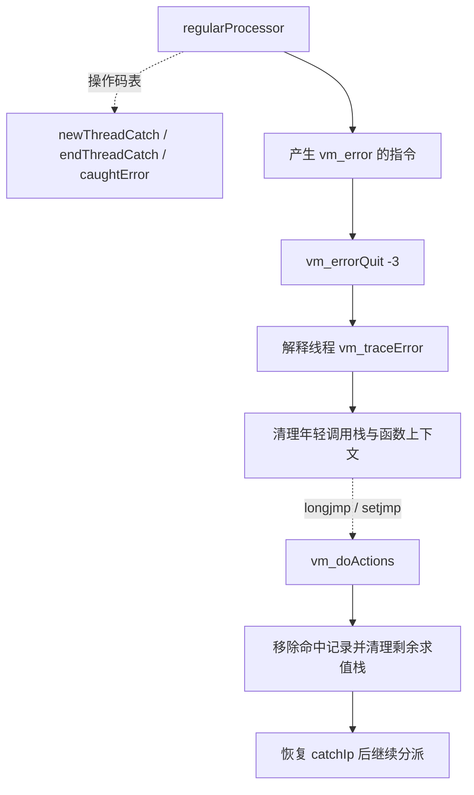

# 阶段 2U：通用异常捕获的静态语义与 Rust 设计

## 一、总体结论

本轮补齐脚本 catch 的注册、正常结束和错误恢复证据，交付后续实现规格。**未修改 Rust 运行时、公共 API、依赖或支持表**：仍为 65 种限定操作码，主语料交集 63 种、缺 10 种，278 项 Rust 测试通过。`0x0e/0x1a/0x2c` 尚未进入支持表，阶段 2 仍未完成。

已确认解释模式的错误目标是 `注册指令 PC + 1 + signed_i16(a)`；捕获保存函数深度和栈指针。正常结束只移除捕获记录，不恢复栈、不压入结果。错误处理先展开年轻调用，再释放注册之后的求值项，跳到错误分支；`0x0e` 执行时仅压入整数 `1`。捕获不是事务，不恢复之前已写入的变量或容器。

原生 ELF SHA-256：`5d4ebac58d8c415d9cf95bbcdd50f78afac91adf4f7e667ea3afc6f5336a6f34`。本轮使用 REA MCP、Ghidra 12.1.4，新增 2 份函数 dossier、2 份汇编记录，复用 18 份原始记录；会话已关闭。所有结论来自静态反汇编、交叉引用、反编译及只读语料，不表示观察过原程序运行。

## 二、原生函数与证据

完整记录及 Evidence ID 见[函数索引](vm-catch-evidence/functions.md)、[结构化清单](vm-catch-evidence/function-manifest.json)。以下均为 ELF 虚拟地址。

| 函数 | 地址 | 作用与证据定位 |
|---|---|---|
| `vm_regularProcessor` | `0x080978c4` | 分派前递增 IP，单参数按 signed par16 传递；复用伪代码及汇编。 |
| `vm_newThreadCatch` | `0x080aaf84` | `0x2c`；检查容量，保存目标、函数深度、SP，更新底层恢复环境深度。 |
| `vm_endThreadCatch` | `0x080aae08` | `0x1a`；递减 catch 数量，更新底层恢复环境深度。 |
| `vm_caughtError` | `0x080ab020` | `0x0e`；调用 `vm_pushNumber(1)`，新汇编和保留伪代码相互核对。 |
| `vm_error` / `vm_errorQuit` | `0x08097b24` / `0x080ab104` | 格式化诊断、按线程记录 last error；错误码 `-3`，特定线程先展开再 longjmp。 |
| `vm_traceError` | `0x08093520` | 打印诊断并恢复指定函数深度；必须结合汇编尾部的实际状态修改理解。 |
| `vm_doActions` | `0x08097008` | 捕获 `-3` 后移除最内层记录，清理剩余求值栈，恢复脚本 IP 或调用专用回调。 |
| `vm_returnFromFun` | `0x08094978` | 先清除本层捕获，再校验返回值，最后执行普通返回。 |
| `vm_popNStack` / `vm_cleanupValue` | `0x08091ab0` / `0x0808ad98` | 值清理链；循环隐藏值最终走 `vm_freeLoopValue@0x080bc884`。 |

### 2.1 注册和正常结束

以下是依据反编译与汇编整理的 C 风格伪代码，省略 ABI 与诊断细节，不是原始源码：

```c
void new_thread_catch(int offset) {
    if (pcb->catchCp >= pcb->catchContextSize)
        vm_error("Too depth catch ...");
    Catch *c = &pcb->catchContext[pcb->catchCp++];
    c->catchIp = current->ip + offset;   // 分派已先递增 IP
    c->funCp = get_current_fun_depth();
    c->sp = vm_sp;
    c->callback = NULL;
    c->cookie = NULL;
    thread->topEnv[thread->topCatch - 1].funCp = c->funCp;
}

void end_thread_catch(void) {
    int count = --pcb->catchCp;           // 原生没有空表/拥有者检查
    int depth = count > 0 ? pcb->catchContext[count - 1].funCp : 0;
    if (thread->topCatch > 0)
        thread->topEnv[thread->topCatch - 1].funCp = depth;
}

void caught_error(void) { push_number(1); }
```

**确认的事实：**注册的 `0x080aafc9–0x080aafdc` 加当前 IP 并保存深度、SP，`0x080aafeb–0x080aaff9` 清空 callback/cookie 并更新恢复环境。正常结束 `0x080aae20–0x080aae25` 无条件递减，整段没有 pop 值栈、压值或函数拥有者比较。

注册新证据：`ev_446aa83f597882387e0856507a84ad5ec466a2e91a4e234c7e9c000ca98eec9a`；结束新证据：`ev_3c2a03d9a2a44bb053d7549ec474236c098efdaddd7ead0a8a811d91c7507797`。

调度汇编的 `0x08097a63` 对单参数 `MOVSX word ptr [EBX]`，与注册函数相加的 IP 共同确认 `pc+1+signed(a)`。`b` 不是此处理器的第二参数。`0x080ab026–0x080ab028` 压入 1 并调用 pushNumber：`ev_9fb21c970e49e1948945a0156491b006ffff02c2dfe7da9caf0a8d96167cad97`，对应保留伪代码 `ev_b8cf22d050dedb8fc06d53d128ce869b74d9bfc40305dca347b34e750ee9ad50`。该指令本身不验证是否刚捕获过错误；常见编译模板和指令原语须分别描述。

**安全边界：**原生空表结束会使计数变为 `-1`，不能称为安全 no-op；跨函数结束也未验证拥有者。后续 Rust 首批对此返回不可捕获的 `InvalidProgram`，保持状态，并明确标为安全差异。注册目标越界不由该原生函数检查；Rust 准备阶段将显式检查。

### 2.2 错误与跨函数恢复

解释线程路径的关系如下；虚线表示依据数据表分派或底层恢复关系，不是静态直接 CALL：



`vm_error` 的 `ev_1b494a92dfe3a6c5943ad427ec0ed25c0e15c7afc6932862b5221a85cb9ef7c7` 与 `vm_errorQuit` 的 `ev_d9b9b1bd2399a379282bc11cbe8575420d3f316770e17d5a6ea5138fdee1b7a1` 确认诊断和 `-3` 路径。`vm_traceError` 的伪代码 `ev_3aa06be9e85308cb2db022171ebc8b97169c4291640f5d39b9176041544f81e4` 及汇编 `ev_e12a1e49fc37b28910632e7d22872a27b51e7c54f0c6478935e893b20f7c63fe` 确认清理顺序：

1. 对 `toFunCp < vm_funCp`，先结束比目标深度更深的 catch。
2. `0x08093ad0` 调用 `vm_popNStack`，将值栈清理到目标函数直接子调用的参数边界。
3. 逐层减少函数深度、更新当前上下文，并按各帧标志释放对象执行引用；最终设置目标深度、更新当前上下文。`flags & 1` 跳过相应对象释放；`flags & 8` 的判断在对象释放之后，不能说它跳过对象释放。
4. 回到 `vm_doActions` 的 `-3` 分支：没有记录则返回 `-3`；否则先移除命中记录，若当前 SP 小于保存 SP，清理其差值，再恢复脚本 IP。

`vm_doActions` 保留伪代码：`ev_1f8d2b76898bf43dd8b24a370fca52729a822af343d566f8bc3216ef0b05c88f`；新汇编：`ev_a280841df7ce885805c45ba2b70f60cf4628279d7dbb748b1f816ba99a1ad2c4`。其中 `0x080970a2–0x080970a3` 移除记录，`0x080971f6` 清理保存栈边界以外的值。不是所有 longjmp 码都会进入脚本处理器：非 `-3` 路径直接返回。

等价于下列受限解释路径摘要：

```c
// errorQuit 的解释线程部分，省略错误输出
trace_error(top_env.funCp);      // 先展开年轻调用，恢复当前函数上下文
longjmp(top_env, -3);

// doActions 从 setjmp 返回后
if (code != -3) return code;
if (pcb->catchCp <= 0) return -3;
Catch c = pcb->catchContext[--pcb->catchCp];
if (vm_sp < c.sp) pop_n(c.sp - vm_sp);
if (c.catchIp == -1) {
    // 注册单独的底层环境后调用 callback(cookie)，不等于脚本 catch
    handle_callback_catch(c);
} else {
    current->ip = c.catchIp;     // 处理器记录已移除；再次报错可转外层
    resume_with_outer_catch_environment();
}
```

该伪代码不是无条件通用的线程、efun、JIT 或回调实现。`newThreadCatch2` 使用 `catchIp=-1`；其 `ev_04c0d19e992575aa438242c9b50d1dc5095f14e6645d2794b5e093f287306ba7` 与 doActions 的回调分支只用于说明现有构造回滚为何不能直接当作通用脚本 catch。

### 2.3 正常返回与资源清理

`vm_returnFromFun` 的 dossier `ev_6a8948bf446a008fa48fc2ecc8711a14fc41635f9cd05e4cfcdacf8bec7a6215` 显示：**先**反复结束 `catch.funCp >= 当前函数深度` 的记录，**再**校验返回值数量、转换和返回类型。返回校验错误不能被已经移除的本函数 catch 捕获；调用者捕获仍可能有效，具体错误来源须单独允许。

`vm_popNStack` 清理值时会进入 `vm_cleanupValue`，隐藏循环值的清理进入 `vm_freeLoopValue`。因此跨函数错误释放年轻帧中的控制槽，而拥有者帧保存栈边界以内的循环状态仍保留。清理控制槽不等于回滚数组内容。相关原始记录均收录于本轮复用包，后续 Rust 实现必须保留真实槽身份和共享头语义。

## 三、只读业务语料

复用主 ABI 的 7,159 个已解码程序、101,592 个普通函数、6,474,773 条指令；初始化段也扫描，隐藏函数数为 0。旧认证与已知 DBA 解压失败成员不在成功解码范围内。详见[方法](vm-catch-evidence/corpus-method.md)、[统计](vm-catch-evidence/corpus-summary.json)、[示例](vm-catch-evidence/corpus-examples.json)。

| 观测项目 | 数量 |
|---|---:|
| `2c` / `1a` / `0e` 各自出现次数 | 3,266 |
| 含注册指令的普通函数段 | 2,495 |
| 按已确认公式计算、在段内且指向 `0e` 的目标 | 3,266 |
| 目标前两条为 `1a`、`1f` | 3,266 |
| 注册与目标之间含调用／跨对象调用的词法区间 | 3,262 / 820 |
| 含循环／返回／另一注册的词法区间 | 21 / 11 / 3 |
| 候选区间最大重叠 | 2 |

`1a/0e` 的原始参数均为 `(0,0)`，`2c` 有 64 种参数组合。区间统计单位为“包含至少一条”，类别可重叠；词法重叠不证明运行时嵌套，返回节点不证明可达，也不证明捕获与结束动态平衡。

代表样本（偏移均为**解压成员内字节偏移**，不是 ELF 地址）：

| 成员与函数 | 注册 PC / 偏移 | 证据片段 |
|---|---|---|
| `gs/pack_data/lib_gs32.pak/gs/daemons/stalld.o`，`save_all_automatism_stalls`，函数 45 | 9 / 194666 | 目标 108；词法区间内 PC65 有另一注册。 |
| `gs/pack_data/lib_gs32.pak/gs/daemons/reportd.o`，`do_when_char_arrive`，函数 26 | 2 / 6398 | 目标 23；PC8 有返回，位于首个词法 end 前。 |
| `gs/pack_data/lib_gs32.pak/gs/start_gs.o`，`remove_client_user`，函数 1022 | 2 / 1096571 | 目标 29；PC6 有循环指令。 |
| `gs/pack_data/lib_gs32.pak/gs/daemons/onlinemalld.o`，`init_custom_pack_mall`，函数 26 | 2 / 25851 | 目标 11；PC6 有跨对象调用。 |

## 四、Rust 首批设计与实施顺序

完整规格见[运行时设计审计](vm-catch-evidence/runtime-design.md)。以下是设计选择，不是已实现能力或原生数据布局：

1. **内部状态与准备检查。**使用私有 `ScriptCatch { frame_id, frame_depth, stack_len, target_pc }`；不持有槽或容器强引用。仅开放普通函数脚本捕获；准备阶段检查目标和生命周期可达链，初始化、构造及回滚 helper 暂不支持。
2. **按具体失败位置分类。**未来仅先允许 `0x19`、两个整数、除数为零的 `IntDivZero`。不能按整个 `VmErrorKind`、错误字符串或所有算术异常判定可捕获。原生 `vm_divValue@0x0808e1a4` 在 `0x0808e27d` 检查整数除数，转到 `0x0808e2ea` 调用 `vm_error`；其汇编 `ev_19597a6d356a5c98c32c16698ef7be5e4ad2201b7a0a22f7a714cc7918dd6f89` 与伪代码 `ev_8ae08d055f9314e0e074d8efe90e725516a1ec2a40a18b7fb1e9bc1014dc355c` 支持该对应。Rust 当前 `checked_div` 把除零和溢出合成同一错误，后续必须增加私有来源标记。`MIN/-1` 原生未见软件保护，继续作为不可捕获的安全错误，不冒充原生 vm_error。
3. **显式两阶段展开。**先完整预检，释放年轻调用的栈资源，再移除年轻帧；随后消费命中记录、截断拥有者求值栈、设置处理 PC。不用公开值快照恢复隐藏控制槽，不跨析构持有借用 guard，不清空仍有效的引用租约索引。无法恢复保存长度时明确失败，不补造值。
4. **维持调度与任务边界。**错误指令占一次预算，路由属于同一步，`0e` 等待下一次指令执行；零预算不处理异常。成功重启清空旧处理器，启动预检失败保持现场。普通未捕获错误继续维持现有粘性失败诊断，生命周期任务仍用自身回滚契约。

首批不新增公开 `Value::Error`、last-error 查询 API 或其他公共类型；不使用 `panic`、`catch_unwind` 或跨 Rust 栈 longjmp。新增失败来源须逐个补证据和合成测试，不能借 catch 隐藏未实现能力。

## 五、验证、限制与下一阶段入口

```sh
python3 docs/vm-catch-evidence/analyze_corpus.py
python3 -m unittest discover -s docs/vm-catch-evidence -p 'test_*.py'
python3 docs/vm-catch-evidence/verify_evidence.py
cargo test --locked
cargo fmt --check
cargo clippy --locked --all-targets -- -D warnings
```

语料统计器默认重新计算并比对快照，只有 `--write` 写生成文件。合成测试覆盖嵌套区间、越界、截断、空输入及分类边界；交付校验核对证据来源、原始制品及历史文件哈希、文档链接和运行时基线。验证记录见[阶段 2U](stage2u-validation.json)。旧阶段哈希仍描述当时 README/路线图，不为本轮改写旧快照。

**仍未确认／未覆盖：**任意原生错误来源是否可安全恢复、全部线程与 JIT/efun 恢复、回调期间再次报错的完整调度语义、宿主 last-error 查询和完整生命周期互操作。没有执行原生程序或原始业务，因此不声称动态差分等价、实际业务捕获成功或完整服务可用。

下一实现批次按本设计加入受限三指令与 `IntDivZero` 路由，以合成程序验证同层/跨层捕获、嵌套再失败、正常返回、分步预算、循环控制槽寿命及引用配额。具体用例、拒绝边界和状态提交顺序已在设计审计中锁定；本轮不提前增加操作码支持数。
