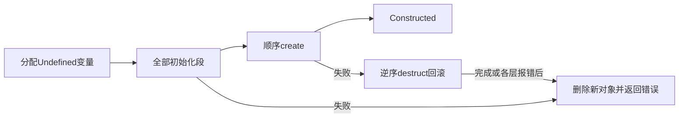

# 阶段 2O：受限构造任务与失败回滚

## 一、总体结果

新增显式生命周期绑定和构造任务：分配新对象，完成所有继承初始化段，再顺序调用各层create；构造失败则逆序调用已访问层的destruct，最后删除新对象并返回首次错误。回滚本身可暂停，单个析构错误不会阻止剩余层。

本轮操作码保持57种，Rust测试共212项（保留191项，新增21项）。没有新增依赖、unsafe或通用catch指令；不开放主动析构、生命周期重入、调度器延迟删除及自动名称查找。所有执行测试均使用内存合成程序，原始制品只读。



初始化证据沿用[阶段2M生命周期分析](vm-object-lifecycle.md)，初始化库接口见[阶段2N](vm-initialization-runtime.md)。本阶段只恢复构造任务内部的错误，不将Rust panic当作脚本异常，也不跨Rust栈模拟longjmp。

## 二、显式绑定与准备

```rust,ignore
use rml32::{ProgramCatalog, LifecycleBinding, LinkLimits, ObjectStore, Vm,
            prepare_constructible_program, Completion, RunOutcome};

let mut catalog = ProgramCatalog::new();
catalog.insert("root", image)?;
// 索引是来源程序自身的本地函数槽，不能填写继承后root中的猜测偏移。
catalog.bind_lifecycle("root", LifecycleBinding {
    create: Some(0),
    destruct: Some(1),
})?;
// 若有继承，每个父来源也必须插入、bind_inherit并显式bind_lifecycle。
let prepared = prepare_constructible_program(&catalog, "root", LinkLimits::default())?;
assert!(prepared.is_constructible());
let mut store = ObjectStore::new();
let program = store.register_program(prepared)?;
let mut vm = Vm::new(store);
let object = vm.begin_construct(program, None)?;
loop {
    match vm.run(1000)? {
        RunOutcome::BudgetExhausted => continue,
        RunOutcome::Finished(Completion::Constructed(id)) => {
            assert_eq!(id, object);
            break;
        }
        _ => unreachable!(),
    }
}
```

依赖闭包的每个来源都必须有LifecycleBinding；没有两个方法的来源填写Default。重复绑定报InvalidProgram。None不能掩盖该来源本地已有的对应名字记录；Some必须选择本地、非空、精确C字符串名create/destruct的实现。拒绝声明、隐藏函数、继承槽、别名及越界；不会自动搜索第一个同名槽或把父方法当作子程序绑定。

只接受void返回。create的声明参数为零个或一个普通mapping/mixed参数；destruct为零参数。原有准备器继续检查参数元数据、默认入口、操作码和atomic限制。链接结束后再给create追加bit0、给create/destruct追加private bit2，随后准备函数；不提前改变链接候选筛选，也不修改原始映像及其raw字节。

create追加bit0意味着声明为零参数时也可接收构造参数；当前有效参数数和实际槽布局仍由原有参数代码处理。有默认mapping的create在None时执行自己的默认表达式。构造入口只接受None或Mapping；其他Value在分配对象前报UnsupportedType。传入的Mapping是同一个共享值，各层修改可被宿主及后续层观察。

`prepare_program`、`prepare_linked_program`、`prepare_initializable_program`不要求生命周期绑定，能力不会自动升级。constructible程序也可单独begin_initialize，此时不调用create/destruct。

## 三、任务和对象状态

新增 `Vm::begin_construct(ProgramId, Option<Value>) -> Result<ObjectId, VmError>`，分配新对象且所有变量为Undefined。旧对象不作为输入。所有初始化段先完成，再按相同初始化排列遍历create；只有全部成功才返回 `Completion::Constructed(ObjectId)`。

| 生命周期状态 | 含义 |
|---|---|
| Unmanaged | 手动创建或仅初始化，不属于构造任务 |
| Constructing | 构造任务进行中，包含初始化与create阶段 |
| RollingBack | 首次构造错误已记录，正在尝试逆序析构 |
| Constructed | 所有初始化及create已完成 |

通过Object::lifecycle_state查询；InitializationState保持独立。create阶段对象已是Initialized，但仍是Constructing，宿主start继续拒绝；任务内部07可调用普通函数，普通start和07始终拒绝直接进入create/destruct。不存在全局放宽生命周期函数权限。

任务中的普通函数帧保持真实分派槽、来源池、metadata及基址。生命周期方法使用正常参数与返回值检查；顶层生命周期返回由内部任务接续，不返回普通Returned完成值。嵌套普通函数返回行为保持不变。

每条实际指令消耗一个预算单位，跨初始化、create和回滚保持同一预算。跳过缺失方法、进入下一阶段、处理入口检查错误及展开帧属于有限元数据转移，不另扣指令数；数量受已验证constitution表限制。run(0)不执行或推进任务。

## 四、失败回滚和取消

create访问游标在参数检查与调用之前递增，因此失败create自身所在层也参与逆序回滚；此前没有create的层如果有destruct，同样参与。初始化失败直接清理新对象，不执行业务destruct。

回滚前清理失败调用的所有帧、参数/计算栈和临时引用额度，再以零参数执行每层destruct。成功结果丢弃；任意VmError均附加至rollback_errors后继续下一层。已经提交的共享Mapping修改不回滚。构造错误始终作为首次错误保留，不能被后续析构错误覆盖。

回滚期间run可能返回BudgetExhausted，暂不返回首次错误；最后清理新对象后才返回Err。重复run返回相同错误。成功开始新普通任务、初始化任务或构造任务后重置附加错误列表；预检查失败不清空之前的结果或诊断。

`Vm::rollback_errors() -> &[VmError]`提供附加诊断。`VmError.lifecycle`为 `Option<Box<LifecycleContext>>`，包含Initialize/Create/RollbackDestruct阶段及所属constitution；嵌套失败的function、source、pc、offset仍指向实际被调函数。生命周期入口参数/额度检查失败时保留目标槽，pc/offset为空。初始化阶段继续填写原有initialization字段。

宿主提前remove对象会终止后续业务回滚；如果已有首次错误则保留它，并把删除造成的错误附加到诊断。所有退出均清理活动帧和任务引用。`into_objects()`取消未完成任务并直接删除它创建的对象，不同步执行destruct；这是明确的宿主取消策略。已完成对象和其他手动对象保留。

物理删除仅发生在本任务帧清理之后；本阶段不实现任意活动对象的execRef、墓碑及backend延迟队列。ObjectStore.remove仍是宿主低层删除接口，不代表新增主动析构能力。

## 五、原生依据与受限差异

复用的REA/Ghidra证据包括：

| 行为 | 地址及Evidence ID |
|---|---|
| 初始化后顺序create、调用前推进游标 | vm_f_construct_object2 `0x080f90b4`，`ev_da96a5f71d49dbc7b88d7cf809835b39c4a15c293342ba20674155e53dfa3606` |
| 创建失败转入回滚 | vm_f_construct_object_failed `0x080f93b0`，`ev_b4cb5e180fe31ab5dc405e16e7a2ebe12a00f0e4e50fc8b530dbceea37e79753` |
| 逆序destruct、零参数和最终清理 | vm_f_destruct_object2 `0x080f9284`，`ev_b1334a21e40fa77529b14cafafd4ce7d1669cdf41e7d2ff014d3bf24431307f3` |
| 析构失败继续 | vm_f_destruct_func_failed `0x080f95e8`，`ev_f4fc3a30d4d10d12d35be2daec518e2e8e8e1c601750a418d198e9540ce61de5` |
| 加载后属性调整 | vm_createProgram `0x080b13f4`，`ev_88e6cc1c7a8abb344478148606a768df6d37a6acd2967f3aee09d0d20d04e62d` |

完整原始观察见[阶段2M证据](vm-object-lifecycle-evidence/index.md)。本轮没有新开Ghidra会话或执行目标。

显式本地绑定、只接受Mapping、void及受限原型、拒绝重入、取消时不执行业务析构均是Rust首批设计，不是对完整原生命名空间和异常行为的声称。全局catch、crash hook、主动destruct_object、动态加载和热更新仍未实现。

## 六、API迁移与验证

新增LifecycleBinding、prepare_constructible_program、is_constructible、begin_construct、Constructed、LifecycleState、LifecycleContext/LifecyclePhase及rollback_errors。Completion穷举匹配需要增加Constructed分支；VmError结构体新增lifecycle字段。

为使扩展后的VmError保持紧凑、通过严格Clippy的大错误检查，message从String改为Box<str>；文本读取和Display不变，直接构造时使用`message: "text".into()`，需要String时用`String::from(error.message)`。lifecycle上下文采用可选Box，不改变全库Result的错误类型，也没有放宽lint。

验证覆盖多父/多层顺序、来源池、共享参数及默认值、无生命周期方法、失败层自身回滚、跳过create但存在destruct、连续析构错误、逐步暂停与恢复、嵌套失败解栈、引用额度与帧限制、取消/提前删除、绑定验证及旧初始化接口。原有191项测试均保留。

```sh
cargo test --locked
cargo fmt --check
cargo clippy --locked --all-targets -- -D warnings
cargo build --locked --bin rml32-inspect
python3 tests/compare_corpus.py --report target/stage2o-corpus-validation.json
```

完整结果和制品保护见[阶段2O验证记录](stage2o-validation.json)。全量语料只核对加载结构，不能当作构造路径执行覆盖或服务端运行证明。
